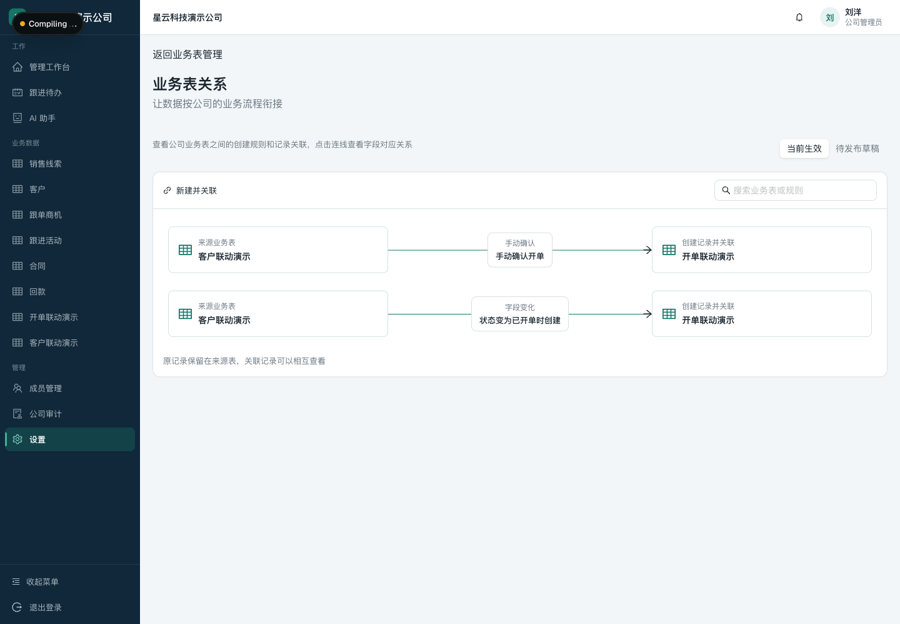
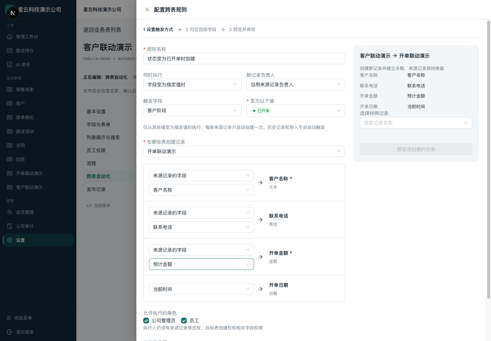
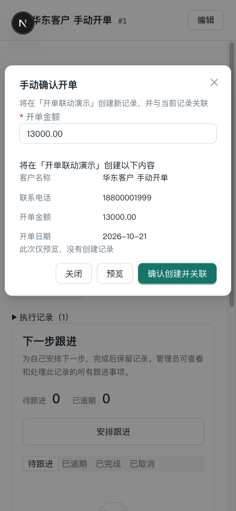

# 跨表关联与自动化：本地验收操作

日期：2026-10-21。仅本地实现与测试，没有推送 GitHub 或同步服务器。

## 和另一个 UI agent 的关系

本功能在根目录的 `codex/cross-table-automation` 分支；整体 UI 在 `.worktrees/ui-direction` 的 `codex/ui-direction` 分支。它们是不同 Git 工作树，没有互相覆盖。UI 分支基线较旧，合并时须保留近期字段停用、整表停用，以及本轮设计器入口、记录详情入口。

本轮使用独立数据库和 Redis、3100/3101 端口。不要把另一个工作树的服务也指向这些端口或数据库。此处不是公司的生产数据，也不是之前 3000 页面的数据库。

## 登录和测试数据

入口：<http://localhost:3100/login>，公司：星云科技演示公司（nebula-demo）。

- 管理员：刘洋，18800001002
- 员工：赵晨，18800001003
- 这两个本地演示账号密码均为 `Demo@123456`

演示表：**客户联动演示 → 开单联动演示**。已有三条演示客户，负责人都是赵晨。华东客户演示手动开单，华北客户演示状态自动开单，华南客户留给继续测试。不要拿同一条客户同时验证两个不同入口并误认为它们是同一次开单。

## 管理员配置

1. 登录刘洋 → 设置 → 业务表关系与自动化，可查看当前生效的关系图。点击连线查看对应字段；切换“待发布草稿”可比较未发布修改。
2. 业务表管理 → 客户联动演示 → 跨表自动化 → 新建规则。
3. 选择“员工点击动作后确认”，规则命名“确认开单”；目标选已发布的“开单联动演示”。
4. 逐行配置：客户名称 ← 来源客户名称，联系电话 ← 来源联系电话，开单金额 ← 执行时填写，开单日期 ← 当前时间。
5. 新记录负责人可选沿用来源负责人或执行人；允许角色仍受原有表/记录/字段权限约束，不会提权。
6. 选择样例客户并填入金额，点击“预览将创建的记录”。这里只读取与校验，不创建订单。
7. 保存规则草稿。此时员工端仍使用旧规则；点击页面上方“发布变更”并确认，员工端才生效。“当前生效”中的规则只能查看，不能误改。
8. 普通字段联动可另建规则：客户阶段变为“已开单”时 → 创建开单，开单金额取来源“预计金额”。自动规则不能要求员工临时输入缺失信息。

## 员工手动开单

1. 登录赵晨 → 客户联动演示 → 打开自己的客户。
2. 在“关联与自动化”点击“手动确认开单”。
3. 填入金额 → 预览 → 核对客户、电话、金额、日期 → 确认创建并关联。
4. 成功后点击“查看新记录”，确认开单表数据和负责人正确。展开“关联业务记录”能回到原客户。
5. 回到客户，可以查看执行时间和成功记录。需要第二笔真实订单时可再次手动开单；网络失败重试同一次操作不会重复开单。

## 员工自动开单

1. 打开一条从未触发过规则的客户，例如“华南客户 待测试”。先确认预计金额有效。
2. 编辑客户阶段：洽谈中 → 已开单 → 保存修改。
3. 客户状态更新、开单记录创建、双向关联、成功历史一起完成。查看“执行记录”中的新订单链接。
4. 只改电话或重复保存“已开单”，不会再生成订单。即使阶段退回再改为已开单，该客户的这一条自动规则也不会再开一单；第二单使用手动入口。
5. 目标必填值不足、权限不足等失败，会连同客户本次修改一起取消；按错误提示修正后再操作。

## 要知道的边界

- 这是一套每个公司自己配置的通用功能，不限定客户/开单表名。关系图表达“在目标创建记录并关联”，不会搬走来源记录。
- 字段在创建时复制；以后修改客户电话不会覆盖历史订单电话。不是实时双向同步、引用列或跨表汇总。
- 导入、历史数据、新建即满足条件不自动补跑。普通更新、批量更新和 AI 确认更新走同一触发判断。自动化生成记录不会递归触发下一层。
- 自动规则每条来源记录只成功执行一次；规则保存/重新发布不会重置去重历史。删除规则后重新新建是另一条规则，应审慎使用。
- 员工必须具有来源记录修改权、目标创建权及相关字段权限。只读员工可以查看自己有权读取的成功历史，不能执行动作。
- 成员字段按成员 ID 关联。员工动作应沿用来源成员字段或管理员固定成员；临时选择成员仅支持管理员动作，避免向员工开放完整成员名册。
- 规则停用/移除须发布，不删除已经生成的记录。字段/整表停用会检查生效规则依赖。
- 执行面板展示最近 100 条成功历史；失败原因在界面反馈，安全审计在公司审计中查询。本轮没有另做失败队列或自动重试任务。
- 桌面支持完整配置；手机支持员工预览/执行和关系总览。业务表设计器沿用现有桌面编辑限制。

## 截图

