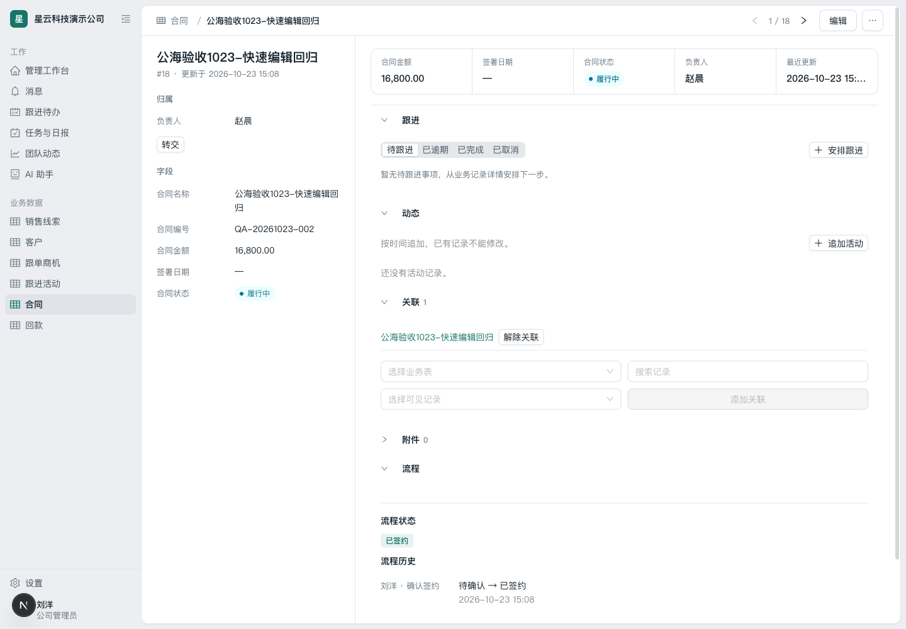
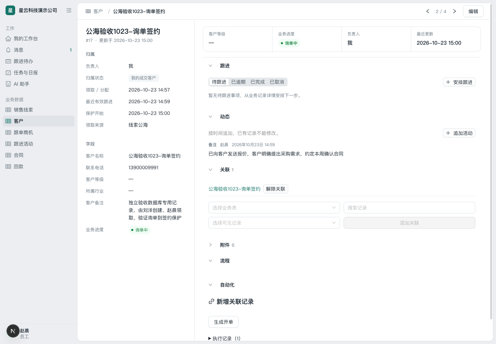

# 本地公海、询单、开单与成交保护：网页验收及操作步骤

验收日期：2026-10-23。代码基线：本地整合 PR #47 + #48 的 `27acfcb`，加本轮确认联系后快速编辑的修复。

## 1. 在哪里测试、使用什么账号

- 网页：**http://localhost:3100**，API 使用本机 3101 端口。
- 公司：**星云科技演示公司**，工作区 `nebula-demo`。
- 公司管理员：**刘洋 / 18800001002**。
- 员工：**赵晨 / 18800001003**。
- 沿用原本的演示账号密码，未重置任何账号密码。
- 本轮从原本的本地演示库复制出 **crm_browser_1023**，放在独立 PostgreSQL 容器端口 55433；Redis 使用专用实例的 DB 2。所有配置与新增记录都写入这份副本。
- 未修改 UI agent 的 `.worktrees/workspace-ui` 或其原演示数据库；未部署、迁移或修改生产服务器。

本轮沿用已有「客户」「合同」两张业务表。「合同」承接开单/签约，没有新建重复业务表。

## 2. 先理解页面中的三个状态

| 页面内容 | 含义 | 是否决定自动回收 |
| --- | --- | --- |
| 客户的「业务进度」单选字段 | 未询单 / 询单中 / 已开单，员工表达业务进展 | 不直接决定；改字段不会延长跟进期 |
| 客户的「归属状态」 | 线索公海 / 客户公海 / 我的待联系 / 我的跟进客户 / 我的成交客户 | 决定领取、期限及成交保护 |
| 合同的「流程状态」 | 待确认 / 已签约，管理员执行正式确认动作 | 已签约且与客户有关联，才触发客户保护 |

「询单」是一个普通、可配置的业务字段，不需要额外创建询单表，也不是停止回收的特殊开关。客户明确提出需求或询价后，由员工选「询单中」。

合同原有的「合同状态」也是普通单选字段。本轮额外配置：执行正式「确认签约」时同步把它设为「履行中」。成交保护始终依据正式流程状态 `signed`，不依据普通字段的文字。

## 3. 管理员的一次性配置

以下配置已经通过网页完成；可以查看现有配置，无需重复创建。

### 3.1 确认员工权限

1. 刘洋登录，进入「设置 → 业务表 → 客户 → 员工权限」。员工应有读取、修改自己负责记录的权限。
2. 「字段与表单」中，客户名称、业务进度和需要录入的字段，员工访问级别设为「可编辑」。
3. 合同表应允许员工新建，并开放合同名称、编号、金额、状态等必需字段的录入权限。
4. 如果成员管理中为赵晨设置过单独的业务表或字段例外权限，也要检查这些例外。公海启用不会自动扩大员工权限。

### 3.2 添加询单字段并发布

1. 「设置 → 业务表 → 客户 → 字段与表单 → 新增字段」。
2. 字段名「业务进度」，字段键 `business_progress`，类型「单选」，允许留空。
3. 点「创建并继续配置」，设置选项：

| 显示名称 | 本次选项键 |
| --- | --- |
| 未询单 | option_1 |
| 询单中 | option_2 |
| 已开单 | option_3 |

4. 员工访问选「可编辑」，点「保存字段」，等页面提示保存成功。
5. 「列表展示与搜索」中勾选「业务进度」，点「保存列表设置」。列表列只影响表格展示，字段权限仍在字段配置中控制。
6. 点顶部「发布变更 → 确认发布」。本次客户表发布为 v16；新字段及跨表规则包含在已发布版本内。

### 3.3 配置正式签约流程

1. 「设置 → 业务表 → 合同 → 流程」，启用流程。
2. 配置状态：

| 状态名称 | 状态编码 | 配置 |
| --- | --- | --- |
| 待确认 | draft | 初始状态 |
| 已签约 | signed | 终止状态 |
| 历史使用中 | active | 保留历史记录使用的旧状态 |

3. 添加动作「确认签约」，动作编码 `confirm-sign`，从 `draft` 到 `signed`，允许角色仅「公司管理员」。动作编码使用小写字母、数字、连字符，不能写下划线。
4. 为了同步合同普通状态，动作下点「添加执行动作」；类型选「更新当前记录」，点「添加字段映射」选「合同状态」。值来源选「固定值」，填 **active**，对应普通字段的「履行中」。这里填写选项键，不能填中文名称。
5. 「保存流程」，等成功后点「发布变更 → 确认发布」。最终合同表为 v4。
6. 若发布检查提示旧记录仍使用某个流程状态，保留该状态，不能直接删除。本次保留了 `active`，没有修改旧合同的状态。

### 3.4 配置客户到合同的跨表开单

1. 「设置 → 业务表 → 客户 → 跨表自动化 → 新建规则」。
2. 规则名称「生成开单」；何时执行选「点击动作后手动确认」。
3. 新记录负责人选「沿用来源记录负责人」。
4. 目标业务表选「合同」，字段取值设置如下：

| 合同字段 | 如何填写 |
| --- | --- |
| 合同名称 | 从来源记录带入 → 客户名称 |
| 合同编号 | 执行时填写 |
| 合同金额 | 执行时填写 |
| 合同状态 | 执行时填写 |
| 签署日期 | 不填写 / 使用默认值，可后续录入 |

5. 允许公司管理员、员工执行。实际执行仍校验来源记录修改权、目标表创建权和字段权限。
6. 「保存规则草稿」，再发布客户表。原客户保留，开单产生新的合同并建立双向关联；字段只在创建时复制，不会持续覆盖两边的数据。
7. 这是一对多关系：同一客户可以有多笔订单，主动再次执行会再建一份合同；单次重试的防重复与同一客户只能开一单是不同规则。

### 3.5 开启分阶段公海并设置保护规则

1. 返回工作区，打开「客户」列表，右上「更多操作 → 公共池设置」。
2. 启用「公共池」，启用「分阶段流转」。
3. 联系期限 **24 小时**，跟进期限 **720 小时 = 30 天**。
4. 点「使用客户预设」，界面名称为线索公海、客户公海、我的待联系、我的跟进客户、我的成交客户。
5. 「成交 / 合作保护依据 → 添加保护依据」：来源业务表选「合同」，已发布流程状态选「已签约」。
6. 点「保存设置」，**立即生效，无需发布业务表**。
7. 旧数据保留原归属，不会自动进入线索公海；已有截止时间不因改配置批量重算。保护规则也不会在保存时把所有旧合同批量追溯为成交。

## 4. 一笔客户从录入到成交的完整操作

### 步骤 A：刘洋创建公海客户

1. 客户列表点「新建客户」。
2. 填客户名称、联系方式及备注。
3. **负责人留空**，点「创建记录」。
4. 详情应显示「未指定」「线索公海」。若选择赵晨，则是直接分配到他的待联系，跳过公海领取。

本次样例：**公海验收1023-询单签约**，客户业务编号 **17**。

### 步骤 B：赵晨从线索公海领取

1. 赵晨登录，打开「客户 → 线索公海」。
2. 打开该客户，点「领取」。
3. 归属应显示「我」「我的待联系」，出现领取时间和约 24 小时回收倒计时。
4. 未领取前是公共资源预览，领取后才可编辑、写跟进和开单。

### 步骤 C：确认联系

方法一：在详情左侧点「确认已联系 → 确认建立联系」。

方法二：在「动态 → 追加活动」选择「电话」并选结果「已接通」，或者微信/消息的成功联系结果，填写内容并保存。成功联系的活动结果也能自动确认。普通备注、未接通不替代联系确认。

确认成功后应进入「我的跟进客户」，开始 30 天跟进倒计时。

### 步骤 D：明确需求后标记询单

1. 客户明确提出需求或询价后，点右上「编辑」。
2. 「业务进度」选「询单中」，点「保存修改」。
3. 刷新页面，确认「询单中」仍在。
4. 左侧仍是「我的跟进客户」，仍有回收倒计时；标记询单不会变成成交保护，也不会重置期限。

### 步骤 E：记录有效跟进

1. 「动态 → 追加活动」，选择真实的活动类型并填写具体沟通内容。
2. 点「保存活动」。
3. 最近有效跟进时间更新，跟进期从该次活动重新计算 30 天。
4. 普通字段编辑、只安排未来跟进待办都不会续期。待联系阶段的普通备注也不会跳过确认联系。

### 步骤 F：创建关联开单

1. 在客户详情展开「自动化」，点「生成开单」。
2. 填合同编号、金额，合同状态先选「拟定中」。
3. 点「预览」，检查自动带入的客户名称及本次填写内容。
4. 点「确认创建并关联」。
5. 点「查看新记录」，应进入合同详情：负责人沿用赵晨，关联中能返回原客户，正式流程状态是「待确认」。
6. 此时回到客户详情仍有跟进倒计时。**仅创建合同还没有成交保护。**

本次员工创建的样例合同：**QA-20261023-001**，金额 **12,800**，业务编号 **17**。

### 步骤 G：刘洋确认签约

1. 切换刘洋账号，打开合同表，找到刚才的合同。
2. 展开「流程」，点「确认签约」。
3. 当前配置带更新字段的执行步骤，会弹出执行说明；点「确认执行」。
4. 正式流程状态变为「已签约」，流程历史记录刘洋及执行时间；普通「合同状态」同步变为「履行中」。
5. 通过「关联」返回客户。客户应变为「我的成交客户」，保留赵晨负责人和保护开始时间，**回收截止时间消失**。
6. 普通业务进度字段不会被跨表关联持续同步。若公司希望列表显示「已开单」，可在客户表手动改成该选项；保护判断不依赖这项文字。

下面是补充同步合同状态后，第二份样例合同的实际页面：

### 步骤 H：赵晨复核保护

1. 赵晨重新登录，「客户 → 我的成交客户」，打开该客户。
2. 应看到「负责人：我」，有保护开始时间，没有回收倒计时。
3. 员工没有普通「释放」或「解除保护并释放」入口。
4. 管理员如确需解除保护，可用「解除保护并释放」，填写原因；不要为了测试随意解除真实成交客户。

## 5. 补充场景：释放、再领取与期限

- 跟进中的客户，员工点「释放」，必须填原因，确认后清空负责人和截止时间，进入「客户公海」，保留业务内容与历史。本轮已通过网页验证。
- 客户公海重新领取后进入「我的待联系」，重新获得 24 小时联系期限；成功联系活动后再次进入 30 天跟进。本轮已验证。
- 超过联系/跟进期限且未成交时，由自动回收任务处理。网页显示到期时间并不表示到期瞬间已执行后台批次。
- 本次没有等待真实 24 小时或 30 天，也没有篡改验收记录时间。到期回收的后端覆盖沿用上一轮自动化测试证据，**不宣称本轮通过网页等待了真实到期回收**。
- 成交保护不会因普通的“询单”或“已开单”字段值停止、开启；必须满足关联和正式状态规则。

## 6. 本轮发现与修复

### 确认联系后快速编辑导致版本冲突

复现：赵晨点「确认已联系」，在确认请求/详情刷新还未结束时立即点「编辑」，表单固定了旧版本；保存业务进度时返回 409，提示记录已被其他人修改。

根因：公海动作刷新详情期间，编辑入口仍可点；服务端并发校验本身正常。

修复：按租户、业务表和记录 ID 跟踪公海操作，确认请求及详情刷新结束前禁用编辑。保留服务端版本校验，不覆盖已经开始的编辑草稿。顺带更正确认联系提示，说明成功联系活动也可完成确认。

验证：先有失败回归，再修复；网页分别给真实确认请求和详情读取增加 1.2 秒延迟，两阶段编辑按钮均禁用；结束后编辑保存成功。延迟只影响测试响应速度，没有伪造接口返回。

修改范围：`record-detail-page.tsx`、`record-pool.tsx`，新增 `record-detail-page.test.tsx`。

## 7. 实际结果与保留样例

| 样例 | 客户 | 合同 | 最终结果 |
| --- | --- | --- | --- |
| 主流程 | 公海验收1023-询单签约，#17 | QA-20261023-001，#17，12,800 | 赵晨持有、询单中、PROTECTED，合同 signed |
| 竞态和释放回归 | 公海验收1023-快速编辑回归，#18 | QA-20261023-002，#18，16,800 | 释放再领取、电话确认通过；客户 PROTECTED，合同 signed，普通状态 active |

第一份合同在追加“签约时同步普通状态”的配置之前确认，因此普通状态仍为 draft；后加流程步骤不会追溯改旧合同。第二份合同验证了最终配置的 signed + active 同步结果。

数据库只读复核：客户、合同原有记录各 16 条均保留，旧记录被自动归类的数量均为 0；分别新增 2 条验收记录。两条客户均为 PROTECTED、无回收截止时间，保护依据未标记待复核。

本轮受影响前端测试：**5 个文件、49 项通过**；Web 类型检查通过；修改文件 ESLint 通过；另由独立审查复核了记录级隔离和异步刷新覆盖范围。上一轮全量整合测试结果见 `local-ui-backend-integration.md`，本轮不重复宣称全仓重跑。

开发模式控制台还会出现既有 Ant Design 弃用提示；本轮记录的业务错误为一次配置编码校验 400（动作编码用下划线，改连字符解决）和已修复的编辑版本冲突 409，未当作全部功能无 bug 的证明。

本轮代码、配置和样例均留在本地，没有推送、合并远程 PR 或部署服务器。

## 8. 后续整合 UI 分支时保留的逻辑

UI agent 正在独立的 codex/workspace-ui-foundation 分支修改页面，其中也涉及 record-detail-page.tsx 和 record-pool.tsx。两边没有直接修改彼此的工作树。后续合并需保留本轮记录级 mutationKey、useIsMutating 等待刷新逻辑，以及成功联系结果的准确提示；合并后复跑本文快速编辑回归及核心角色流程。不要用整个文件覆盖来解决冲突。
