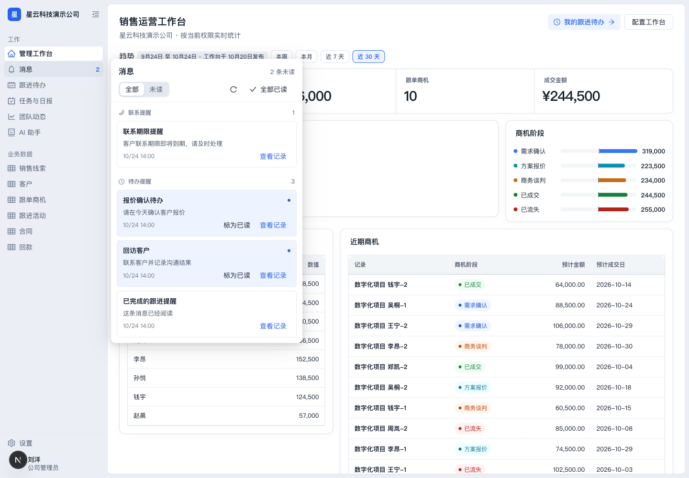
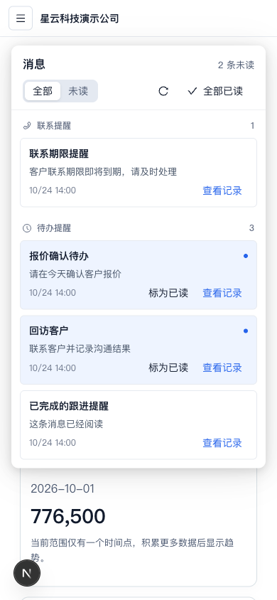

# Phase 3 整合验收与工作树清理

日期：2026-10-24。基线 main ece2926，UI PR #54 eb884ea，品牌图标 PR #53 f601685。本任务在既有独立工作树 codex/phase3-review 整合，保留两个原提交，未改 UI agent 的工作树、测试库或生产环境。

## Standards 复核

修复流程服务端错误持续强制展开同一个动作的问题，改为每次失败只定位一次。流程保存后读取真实对象草稿，刷新待发布状态；读取失败明确提示。只有返回版本与本次保存版本相同才接纳，并发更高版本不会被配给旧流程表单，避免绕过冲突保护。新增回归先失败再通过，补修后二次只读复核无剩余阻塞。

## Spec 复核

基本设置、列表设置在保存期间锁定全部相关控件，防止保存响应递增版本、重挂载时吞掉后续输入。自动化规则编辑 dirty 状态接入父级离开保护，关闭、放弃、保存、卸载会清除。默认列预览明确是配置预览，员工实际列受字段权限、成员例外和个人偏好影响。无新 API、数据库迁移或权限规则。

## 发布差异修复

已确认后端 JSON.stringify 比较把 jsonb 属性顺序差异误报为字段修改。改用 Node isDeepStrictEqual，对象属性顺序不影响结果，数组顺序和真实值变化仍保留。回归覆盖重排键、标签修改、嵌套校验变化；真实网页发布仅权限/流程变更后，历史显示“没有字段变化”，不再误报全部字段。历史快照和业务数据不重写。

## 消息列表

卡片间距 8px、分组间距 16px，缩小内边距，时间与操作同行。保留完整正文、未读点、逐条/全部已读、筛选和分页。修正 Ant Design 6 popover 容器选择器及其内边距覆盖，手机浮层定位到视口安全边距；390px 实测 x16、宽358，桌面宽400，短消息高约97px。测试数据通过浏览器请求拦截提供，已读计数3→2；不写真实消息或业务记录。

## 验证

- Web：118 files /1042 tests，架构检查3项。
- API：113 suites /1567 tests；完整 HTTP E2E：21 suites /199 tests。
- monorepo build/typecheck、受影响 TypeScript ESLint、diff --check 通过；最终消息 CSS 另做 Web 生产构建。
- 新建隔离库 crm_phase3_acceptance_1024，来自本任务自己的 crm_member_directory_1024。刘洋管理员真实操作：流程保存、发布状态、推进说明只读草稿→发布v2→历史核对；自动化规则输入后 beforeunload 被阻止，放弃后可离开；延迟保存时基本输入被锁定。赵晨员工新建表单显示只读提示，配置器地址为404。消息在1440/390验收。UI agent 的 crm_ui_designers 未修改。
- 原 PR #54 的六项 CI 已通过；整合头需另通过六项 CI 后合并。显式引用 Next 自带静态图片声明，避免图标依赖本地 next-env.d.ts 缓存；排除 next-env.d.ts/.next 的临时配置先复现 TS2307，补声明后类型检查通过。

## 工作树清理

移除 crm-redesign、workspace-settings、workspace-ui、workspace-ui-before 四个已合并且无未提交修改的旧工作树。使用非强制 git worktree remove，保留所有 Git 分支。删除前将被忽略的本地配置和设计素材压缩到主目录 .worktrees/.cleanup-backups/2026-10-24，私密权限，manifest记录来源提交、归档清单和校验值；不提交备份内容。

保留主目录（有未提交修改）、crm-audit（未提交验收文档）、crm-domain-landing（未提交参考素材）、landing-refresh（未提交报告）；ui-direction 仍有打开文件，保留。workspace-designers 正运行 UI agent 服务，即使合并后也保留。本任务工作树用于本地验收服务。没有强制删除、重置或终止其他 agent 进程。

## 既存后续项

工作台运行时尚未按已保存 width 布局，属于第四阶段；历史演示数据中的数值金额与字符串金额不统一、自动化运行预览仍显示选项原值和 ISO 时间、无规则级汇总执行统计，沿用原 PR 披露，未以假显示掩盖，也未改写旧数据。

本轮不部署、无生产迁移或数据操作。第四阶段从整合后的最新 origin/main 建独立工作树，处理日常工作区、任务日报、团队动态、AI和工作台运行布局，保留前三阶段行为。
