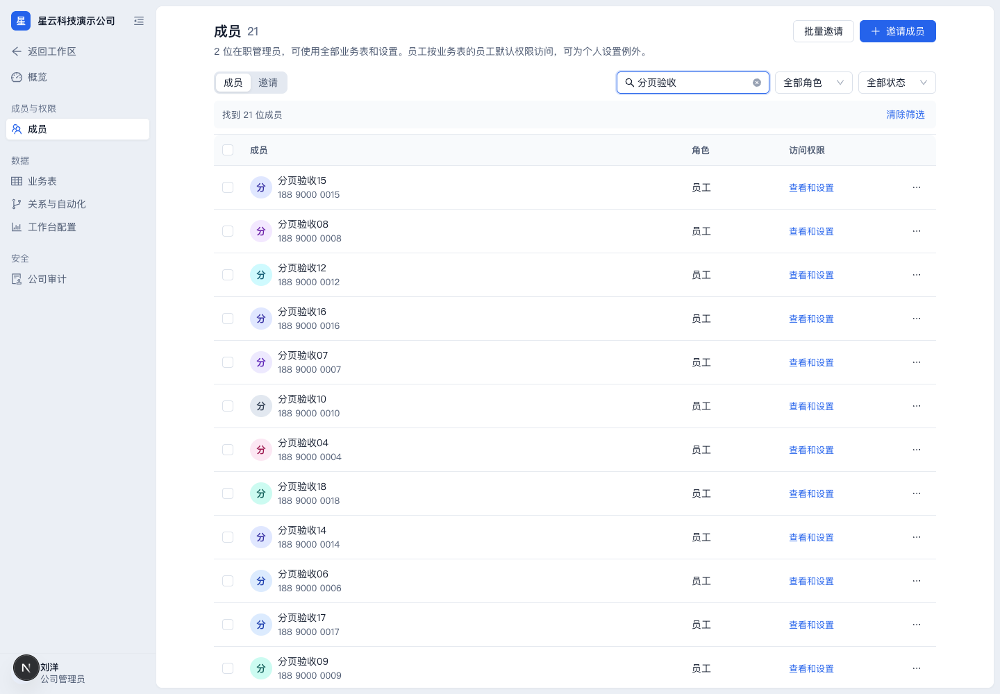
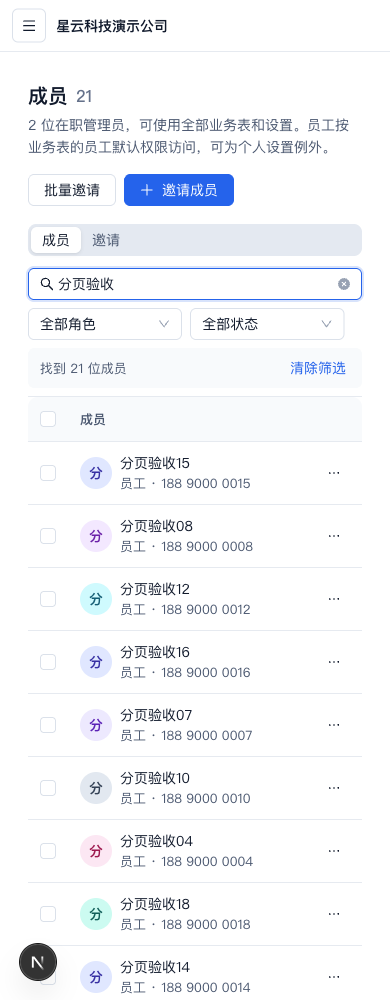

# 第二阶段设置与成员管理：整合验收

日期：2026-10-24。原 PR #51：399f82670f6b4d7080529c8e6ea5fcb225fbba5b；基线 main：5325ff57f9df18bf20d9bb93bf03fabf17211a03。本任务在已有独立工作树 codex/member-directory-review 补修，未修改 UI agent 或主目录中的已有文件。

## Standards：规范与正确性审查

未发现原 PR 新增租户、鉴权或数据持久化越界。保存权限期间编辑器锁定，失败保留草稿；邀请成功后只刷新缓存，注册链接和批量邀请结果不再因重挂载丢失。表级恢复默认不会误删列例外。保留公司管理员、员工既有权限边界和最后管理员保护，无新增依赖或数据库迁移。

## Spec：需求及缺陷处理

1. 原 PR 有姓名/手机号搜索和角色、状态筛选，但浏览器最多取 50 页 ×100 人，超过 5,000 人静默漏搜。已改为服务端 q/role/status + page/limit，取消全名册加载。姓名按公司内展示姓名优先、账号姓名回退；手机号可用带空格片段；数据和总数使用同一过滤条件。
2. 筛选结果减少后，最后一页可能仍停在旧页码。成功刷新后自动纠正到有效页，切换条件和分页清空本页选择。
3. 请求失败被显示为找到 0 人。已让错误态优先，提供原查询重试，不显示假零结果；管理员人数未知时也不显示 0。
4. 筛选后翻页和刷新需要保留条件。地址保存 q/role/status/page/limit，服务端恢复；300ms 搜索防抖在卸载或条件变化时清理，查询键和初始数据包含完整条件。
5. 重复 URL 参数会令 q 成为数组。服务端页面忽略重复或非法参数，避免 array.trim 导致 500。

成员页支持每页 20/50/100 人。管理员总数仍按全公司计数，不受搜索和角色/状态过滤影响。接口继续仅对公司管理员开放，查询显式 tenantId 且保留 RLS。

## 自动化验证

- Web 全套：118 files /1022 tests；架构检查 3 项。
- API 全套：113 suites /1566 tests，含独立 Redis 限流验证。
- API E2E：21 suites /199 tests，包括真实数据库的组合查询、分页、姓名覆盖、空结果、非法参数、跨公司隔离和员工拒绝。
- 成员/权限/设置定向：39 项；SSR 参数及成员列表最终定向 20 项。
- monorepo build、typecheck、本轮文件 ESLint、diff --check 通过。接口生成仅新增成员查询的可选参数。
- 回归均先验证失败再修复；原 UI 非本轮行为保证的断言保留。

## 真实网页验收

本地 http://localhost:3140，API 3141，数据库 crm_member_directory_1024，由本任务原有 crm_browser_1023 复制。原库 10 名成员不变；副本新增45个假成员，总55人，无短信发送。未使用 UI agent 的 crm_ui_settings 或生产数据库。

刘洋管理员：姓名搜索21人，第二页1人；翻页、刷新保留查询。角色与在职状态可组合，管理员总数始终2。停用末页唯一测试成员后结果缩到20人，自动返回第一页；随后已通过网页恢复该测试成员。每页50显示50行，100显示55行。手机号188 9000 0045可找到对应成员。网络503拦截时显示错误，不伪装零结果，解除拦截后重试成功。成员权限页明确显示员工默认发布生效、成员例外保存即生效；设置概览可正常读取状态。

赵晨员工：成员页显示管理员专用及返回工作台，没有搜索名册或管理入口。1440/900/390均无页面横向溢出；实际截图如下。

## 既存边界及发布状态

成员权限详情页的姓名仍从前100人中查找，大公司后续成员可能显示“该成员”；这是原有标题回退，不影响服务端权限判断，本轮未扩大为新的成员详情API。跨表同时编辑多个权限草稿时，刷新其它表可能关闭草稿的既存行为亦未在本轮重构。

本轮只整合代码并提交验收；未运行生产部署、迁移或线上数据修改。后续 UI 第三阶段从合并后的 main 新开独立工作树和 PR，重点业务表设计器、关系与自动化及工作台配置界面，不改变业务规则。
