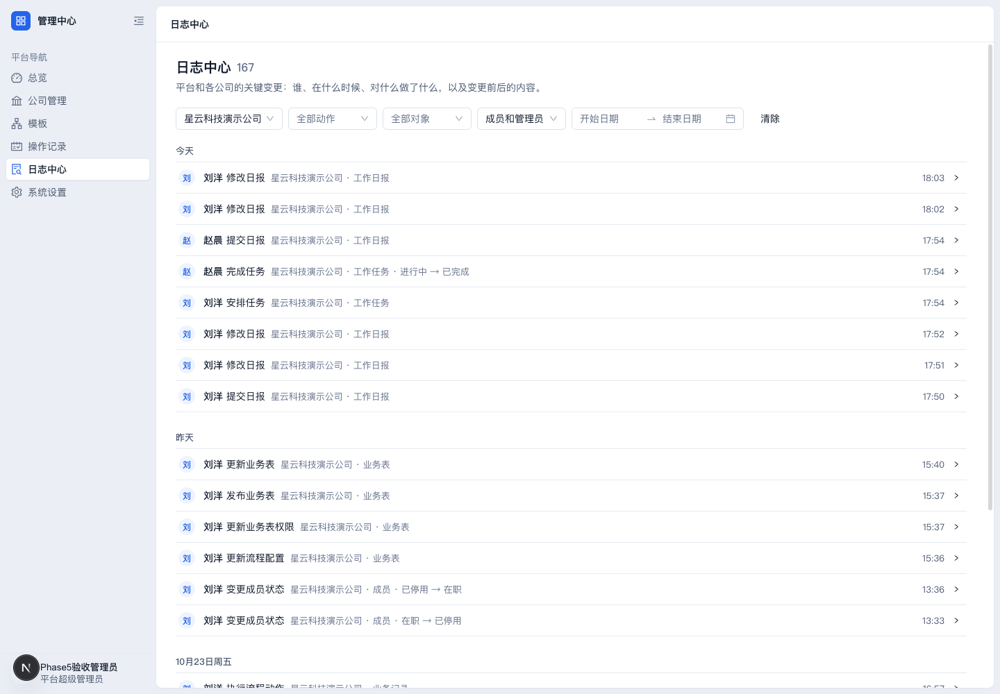
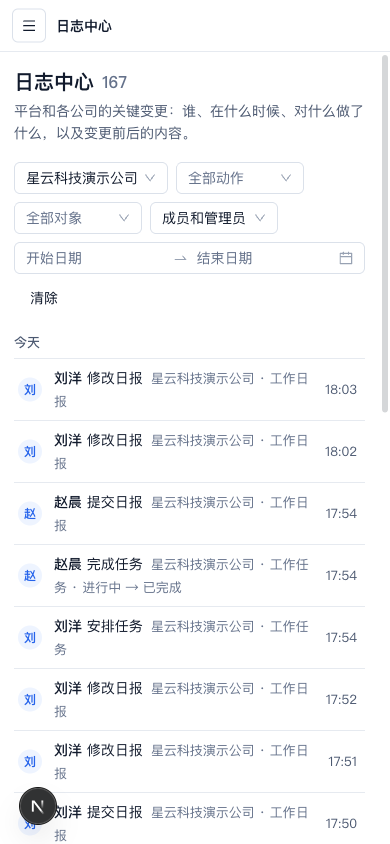

# Phase 5 整合验收

日期：2026-10-25。基线 main `1a67aa0`；原 UI PR #58，提交 `1596054`。在本任务已有独立工作树、分支 `codex/phase5-review` 通过 merge commit 保留原 UI 提交，再添加补修。没有修改 UI agent 的分支、工作树或数据库，没有部署、迁移或修改生产配置。

## 复核结论与实际补修

原改动覆盖平台总览、公司管理、业务模板、操作记录、平台/公司审计、账号安全和无权限/失败页面。既有后端权限与接口保持不变。按代码规范和需求一致性两条线独立审查，补修如下：

1. **快速连续筛选丢条件**：审计筛选处理函数各自合并旧服务端参数。立即记录待提交条件，再合并后续选择；新服务端结果到达后同步。清除筛选与翻页仍保留正确参数。
2. **新筛选带入旧页码**：等待新结果时旧分页仍能发起第 3 页，使仅一条结果的筛选显示空列表。新筛选未提交时忽略旧分页事件；结果返回后恢复分页。
3. **误判日志语义**：部分删除/更新日志只有 after 快照，不代表创建。单侧快照显示“记录内容”，双侧显示“变更内容”，保留原始 JSON；不靠快照缺失猜测创建或删除。
4. **筛选选项加载失败被当成空数据**：facets 失败显示明确错误及重新加载入口，已成功返回的日志仍可查看，不再提示成“没有可选的动作”。
5. **公司统计失败导致状态筛选消失**：状态入口始终可用；统计失败不显示伪零数，提供重试，列表可继续查看。重复 search/status/page 参数按无效参数忽略，避免 array.trim 抛错。
6. **模板浏览器返回丢稿**：现有离开提示仅覆盖应用链接和刷新/关闭，无法拦截浏览器后退。复用根 QueryClient，在同标签页内按用户、模板保存聚合草稿，返回时恢复并提示。保留原始版本号，继续由后端拒绝过期覆盖；保存成功或明确放弃清理缓存。
7. **模板旧保存响应污染新草稿**：复核补修发现仅按 revision 判断不足。每轮草稿拥有独立 sessionId，恢复沿用，放弃后重新生成。旧响应仅能清理或推进同一轮草稿，无法删掉重新开始的编辑。

没有新增依赖、后端 API 或数据库迁移。两位复核者最后对旧分页和草稿归属的修复作了窄复核，未发现剩余确定缺陷。

## 验证证据

- 原五条回归先验证 **5 failed**，修复后通过。
- 模板恢复两条回归先验证 **2 failed / 16 passed**，修复后通过。
- 旧分页与旧保存响应各先复现一条失败，再修复。
- 最终补修定向：3 files / 25 tests passed。
- 最终全套 Web：**123 files / 1084 tests passed**，架构约束另 **3 passed**。
- 本轮补修文件 ESLint、全仓 typecheck、全仓 build、git diff --check 通过。
- 首轮类型检查发现测试误用 Testing Library 的 exact 参数，已修正；第一次全仓检查缺 DATABASE_ADMIN_URL，补齐隔离本地库环境后通过。
- 原 PR #58 六项 CI 均通过；本整合 PR 的最终头提交还必须通过 Typecheck / Contracts / Unit Tests / Build / Database Integration / Critical API E2E 后才能合并。

## 独立真实网页验收

沿用本任务 Web 3140 / API 3141、数据库 `crm_phase3_acceptance_1024`。未改动 UI agent 的 3730/3731 或 `crm_ui_platform`。

- 平台角色使用本轮新建的合成本地验收账号，通过开发固定验证码正常注册，再用现有 platform-admin:grant CLI 授权；CLI 留审计。没有真实短信或外部 AI 调用。
- 平台总览、公司状态筛选、模板列表可读取实际本地数据。公司列表正确显示既有管理员但没有邀请记录，不假报邀请异常。
- 编辑模板业务表名称 → 浏览器后退 → 前进：输入及恢复提示都在。点返回业务模板 → 明确放弃 → 再次进入，恢复服务端原名。测试没有保存或发布模板。
- 公司筛选和操作者筛选可连续组合，地址同时保留两项。实际 daily_report.updated 只有 after 快照，详情显示“记录内容”，不再误报创建。
- 刘洋管理员可查看公司审计。赵晨员工访问团队页显示无访问权限并有返回工作台入口，无管理导航。
- 赵晨账号安全页、活跃设备与登录历史切换正常。没有改密码、撤销会话或接收/拒绝真实邀请。
- 平台审计 1440 / 390、账号安全 390 检查无横向溢出。截图检查完成。

本轮本地持久化仅新增合成平台验收账号、授权审计及测试登录/验证码记录。已有公司业务记录、模板、流程未更改。

## 保留边界

模板恢复只保护已进入模板聚合草稿的修改；字段配置抽屉和“新增业务表”弹窗中还没有点确认的输入仍是临时表单。内存恢复仅限当前标签页的客户端前进/后退；刷新或关闭使用浏览器原有未保存提示，不承诺跨刷新或跨浏览器持久化。

现有后端问题与功能缺口另见 [后端后续清单](backend-follow-up.md)。UI Phase 5 验收通过不等于这些问题全部修完，也不代表服务器已经运行此版本。
