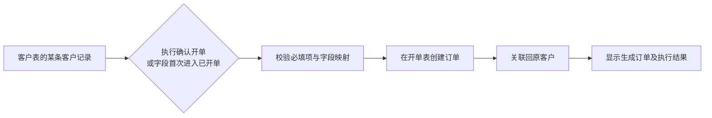

# 跨表关联与自动化：建议方案

日期：2026-10-20。状态：供确认的产品方案，本轮没有实现新跨表功能或修改任何公司的流程配置。

## 结论

采用“记录关联 + 触发条件 + 创建动作 + 字段映射”，每个公司由管理员配置。复用现有流程/动作引擎；增加清晰的规则配置、预览及关系小图。先做好可解释的有限规则，不做任意拖拽编程画布。

客户资料留在客户表，开单后增加一条订单记录并关联原客户。按一个客户可以多次开单设计，不能把客户从客户表搬走，也不能把客户ID当成所有订单的唯一编号。

## 当前代码实际已有的能力

- 流程状态变更：`apps/api/src/modules/workflows/workflow-runtime.service.ts`。
- 创建其他业务表记录、字段映射、创建记录关联、创建跟进：`apps/api/src/modules/actions/action-engine.ts`、`action.types.ts`。
- 当前字段、固定值、当前时间、当前负责人、执行人、前一步结果等取值来源。
- 管理端已有目标业务表、字段映射、负责人、关联前一步结果的编辑器：`apps/web/src/features/objects/workflow-action-editor.tsx`。
- 员工执行流程动作时进行确认；源状态和后续创建/关联在一个事务中完成，任一步失败全部取消。按执行人权限检查，不隐式取得管理员权限。
- 普通单选字段的保存不等于流程状态变更。当前不能承诺把普通字段改成“已开单”就会触发动作。
- 当前关联是记录之间的通用关系，不等于已经具备可命名、强制一对多约束的关联字段或实时查找引用列。

## 常见做法与方案比较

[Airtable 的创建记录动作](https://support.airtable.com/articles/4705968598-airtable-automation-action-create-record)采用触发器后接动作，指定目标表，再给目标字段设置固定值或前一步的值。[HubSpot 的工作流关联](https://knowledge.hubspot.com/workflows/manage-crm-record-associations-with-workflows)区分创建新记录时建立关联和关联已有记录。[Zoho 的线索转换](https://help.zoho.com/portal/en/kb/crm/sales-force-automation/leads/articles/convert-leads)使用管理员配置的字段映射将值带入其他模块。

| 方案 | 判断 |
| --- | --- |
| 为某公司写死客户→订单代码 | 上手快，但换表名、字段或公司就要改代码，不推荐 |
| 管理员配置触发条件、创建动作、字段映射，生成关系预览 | 推荐；通用且可控，能复用本项目现有能力 |
| 完整拓扑编程画布，任意分支、循环、跨表双向同步 | 当前成本及误配置风险过高；没有实际需求前不做 |

关系图是配置的展示方式；决定行为的是明确保存的规则。连上一条线不应默认开始搬数据或双向同步。

## 客户与开单例子

关联使用稳定的记录ID，不能用姓名或手机号文本作为自动关联依据。客户名称相同也不会串单。

| 开单表内容 | 建议来源 | 含义 |
| --- | --- | --- |
| 关联客户 | 当前客户记录ID | 跳转回原客户，不复制客户身份 |
| 客户名称、电话（如确有需要） | 客户对应字段 | 开单当时的快照，创建后不自动覆盖 |
| 订单负责人 | 当前客户负责人；为空时明确要求选择 | 成员ID，不用同名员工文本匹配 |
| 开单日期 | 当前时间或本次填写 | 明确公司的时区 |
| 订单金额、产品、合同号 | 本次填写或源表明确存在的字段 | 缺少必填值时阻止完成，不假造 |
| 订单状态 | 管理员指定目标表的有效选项 | 必须与目标业务语义一致 |

金额等信息只在开单时确定的，优先使用“确认开单”动作弹窗补充必填项。只有来源字段已齐全时，才适合无额外输入的字段变更自动化。

## 建议确认的行为默认值

1. **两种入口共用一个动作引擎。** 优先提供明确的“确认开单”流程动作；需要普通单选字段联动的公司可另选“字段值变更”触发器。不能把两个重复规则同时当作同一次开单入口而生成两单。
2. **字段变更只在跨入条件时触发。** 比较旧值与新值，已开单→已开单、修改备注、打开页面都不触发。新建记录即满足条件另设显式开关，默认关闭。历史满足条件的记录不自动补跑。
3. **防重复区分请求和业务。** 同一规则同一源记录事件仅执行一次，并发及重试由数据库唯一约束保护，保留已创建目标ID。规则修改/重新发布不重置已有成功记录。默认“首次开单”规则每客户只自动生成一次；重置状态再改回来也不重复创建。第二张订单走明确的“新增订单”动作，支持同一客户多个订单。
4. **单次执行整体成功。** 字段修改/流程变更、创建订单、建立关联、成功历史在一个事务中提交；目标停用、必填缺失、无权限等失败时全部取消，并显示具体原因。临时失败可重试，权限或配置错误先修正。失败详情不向无权限员工泄露字段内容。
5. **原始权限仍有效。** 员工需要源记录操作权限及目标创建/对应字段权限；创建关联还需有权读取相关记录。配置时提示角色冲突，运行时仍检查。首版不提供管理员身份代执行。
6. **字段兼容性显式检查。** 允许兼容类型；单选/多选按有效选项键映射，成员按ID映射。名称相同只作为建议，不自动认定相同语义。文本转金额、单选转多选等需要明确转换，不静默猜测。
7. **关联、复制、实时引用分开。** 首版支持关联和创建时复制；实时引用列和跨表汇总后续独立设计。修改客户电话不会覆盖历史订单快照；用户可沿关联查看当前客户资料。
8. **订单撤销有独立业务动作。** 不因客户状态改回而删除既有订单。订单取消/退款保留历史；公海保护继续按管理员配置的实际订单状态/关系判定。“创建订单”不自动等于“已收款”。
9. **导入默认不触发。** 页面明确说明，避免导入一批历史客户就生成订单。第一版不增加批量历史回填；后续如需要，必须先预览影响范围再确认执行。手动、批量编辑及AI写入使用同一规则判定，不能出现只有网页某入口触发的差异。
10. **不递归连锁。** 首版只执行当前规则内的有限顺序动作；其写入不会自动递归启动其他规则。配置页面明确这一边界；不提供循环或任意脚本。
11. **配置发布及停用依赖统一。** 编辑→校验→无写入预览→发布生效，复用业务表版本管理。源/目标停用或字段停用、改类型、删除选项前显示受影响规则；不能保存出隐含坏连线。关联和日志按公司隔离，历史记录不被规则停用删除。

## 页面建议

入口保留在业务表的“流程与自动化”，另给公司设置一个“业务表关系”总览入口，使用同一份配置，不再增加一套互相覆盖的配置。

- **公司关系总览：** 表为卡片节点，线分别标注“记录关联”和“自动创建”，结合图例及线型区分，不能只靠颜色。默认只显示表级关系和启停状态，支持搜索、聚焦一张表、缩放。点击边打开规则说明。
- **规则编辑：** 左侧依次设置触发来源、条件、目标、动作；右侧固定小图预览“客户→确认开单→开单表”。默认表单配置驱动图，不要求管理员拖线才能完成。
- **字段映射：** 左侧源字段，右侧目标字段，中间有短连线；以目标必填字段为主逐行配置。支持下拉选择及键盘操作，兼容字段优先建议，类型不兼容显示原因。只展开当前选中规则的字段线，避免全公司字段挤成一团。
- **执行预览：** 选一条有权读取的样例，展示将创建的目标内容、负责人和关联，不写正式数据；缺失值、权限冲突、停用目标逐项说明。
- **运行结果：** 员工看到成功/失败、生成订单入口和可理解的失败原因；管理员看到规则版本、时间、执行人、源记录、目标记录及重试情况。失败无成功记录，重试成功后能对应原失败。
- **视觉：** 白底、黑字、蓝色强调，红色用于失败和危险操作；沿用现有组件。选中/连线/抽屉提供短过渡，支持减少动态效果。手机以步骤卡片替代复杂画布。

## 建议开发顺序

先打通一个完整切片：现有流程动作的引导配置、创建并关联、字段映射预览、必填补充、成功目标链接及关系小图。底层复用已有动作/关系/权限/事务，不另建一套工作流系统。

随后在同一配置和动作引擎上补字段变化触发、持久化去重与执行记录，覆盖普通编辑、批量/AI、导入不触发、回退重进等边界。没有这部分就不能宣称“普通字段改为已开单即可自动创建”。两段可作为同一轮交付中的实现顺序，统一验收后启用。

验收必须包含：同名客户不串联、重复点击/重试不重复开单、同一客户可明确新增第二单、必填不足全回滚、员工权限不足全回滚、源/目标停用、单选值映射、历史数据/导入不意外触发、客户更新不覆盖历史订单、规则变更不重跑旧事件、公司隔离、手机操作及无写入预览。
