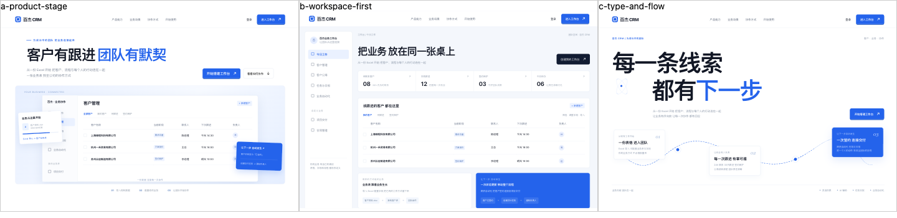
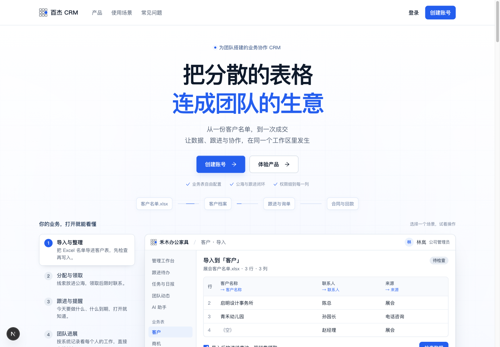
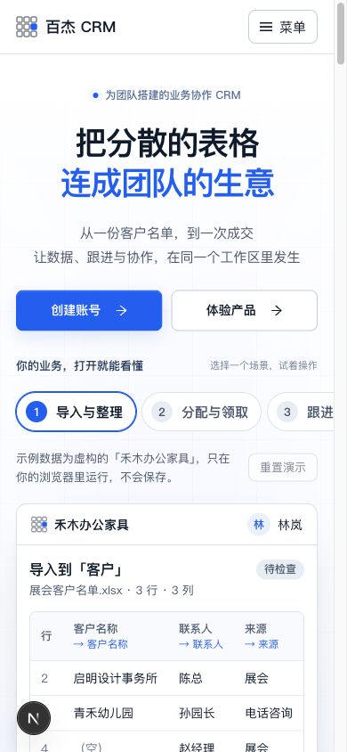
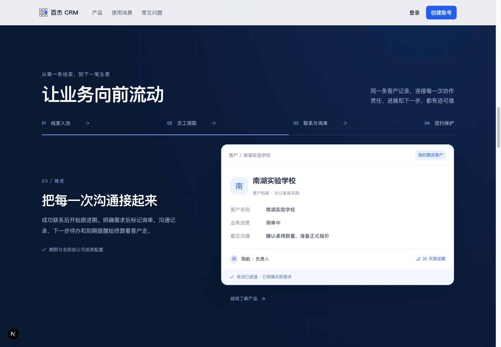

# 百杰 CRM 首页改版：设计与验收

日期：2026-10-23。仅本地分支 `codex/landing-storytelling`，基于独立角色验收完成的 `f42ec7f`。没有合并、复制另一个正在开发的 `codex/workspace-ui-foundation`，没有部署服务器，也没有更改其数据库或工作树。

## 设计目标与参考

用户需要一张信息完整、有业务辨识度和连贯动效的 CRM 首页，保留可切换的产品演示。北极星：让一条业务记录从分散表格走到团队成交。主要入口是创建个人账号、体验产品与登录；注册不会自动创建公司或获得公司权限。

本次实际浏览和截图参考：[Attio](https://attio.com/)、[Linear](https://linear.app/)。从 Attio 保留产品画面承载主张、紧凑导航与清楚主操作；从 Linear 保留界面细节与整页章节节奏。没有复制标识、文案、客户背书或产品能力。采用百杰的白、黑、蓝配色，避免照搬全黑背景与海外获客话术。

动效方案参考 [GSAP ScrollTrigger](https://gsap.com/docs/v3/Plugins/ScrollTrigger/) 和 [matchMedia](https://gsap.com/docs/v3/GSAP/gsap.matchMedia()/)。新增固定版本 GSAP 3.15.0，只用于首页；包声明为标准 no charge license，没有把它称为 MIT/OSI 开源许可。上游许可网页本次重定向维护页，包内声明与 README 可读。依赖锁文件只新增这一项，不夹带其他依赖升级。

## 方向取舍

按用户授权自行比较三个首屏：A 通栏标题与产品舞台，B 画面即工作台，C 满版文字与流程轨迹。静态原型在 /tmp/crm-landing-research，缩略对比归档如下。选 A，原因是容易承载五个可操作场景，同时可以把真实业务流转放进中段；B 过早要求用户理解后台，C 的内容承载较少。

全页结构：产品首屏与五场景演示 → 同一客户的四阶段流转 → 业务表、权限、公海、跨表能力 → 员工工作台与团队进展 → AI 数据问答 → 注册加入步骤 → FAQ → 行动区与公司页脚。

## 实际实现

- 重做首屏标题、层级、背景与操作布局；手机端优先让演示表格在首屏可读。
- 保留原有五场景演示及键盘操作、导入、公海、任务、AI 确认和重置逻辑。演示仍为同一虚构公司，没有发真实请求或访问账号数据。
- 增加客户从导入、领取、联系询单到签约保护的滚动叙事；沿用同一个客户和负责人，解释期限可配置，询单不会代替正式签约保护。
- 增加工作台、任务提醒与 AI 来源示意；没有承诺自动拨号、自动加微信、短信业务提醒等尚不存在的能力。
- 页脚保留主体公司和备案链接，只指向 CRM 子站内部与已有认证入口。
- 删除多余技术实现说明，改为数据权限、员工任务、关联合同等可理解的结果；没有添加路线图、测试版或版本标签。

## 动效与回退

首屏按阅读顺序出场；按钮悬停、按下与菜单展开保留反馈；产品场景切换沿用原交互。滚动叙事采用 GSAP ScrollTrigger，正常滚动直接驱动客户阶段转换，回滚可倒放，不接管用户滚轮。各阶段先退出再进入，避免文字叠影。

减少动态效果时取消固定与变形，四阶段按顺序完整展开；短手机屏（高度不超过740px）也采用静态阅读布局，避免内容被固定舞台裁切。无 JavaScript 时服务端内容直接可读。卸载与偏好变更清理动画及滚动监听。动画画面对辅助技术隐藏，同时提供常驻的完整语义流程列表，四阶段无需滚动即可被屏幕阅读器读取；该缺陷先通过失败回归复现，修复后自动测试与真实浏览器角色查询均通过。系统页面、全局样式、后端与数据库未因首页改版修改。

## 验证边界与结果

首页改版开始前，独立业务版本重新通过：Web 113 文件 / 959 项测试、3 项架构检查；API 单元 112 组 / 1,562 项通过，另 3 项跳过。使用刘洋和赵晨在 crm_browser_1023 副本网页完成客户#19、合同#19的领取、询单、跟进、开单、管理员签约和成交保护。具体记录见 ../../audits/2026-10-23/pool-inquiry-browser-walkthrough.md。

首页最终相关验证：12 项交互回归通过；Web 类型检查、修改 TS/TSX 的 ESLint 和 diff check 通过。没有在纯首页改动后再次声称跑过全仓测试或生产构建。

浏览器：1440×1000、900×800、390×844、375×667 均未出现页面横向溢出；五场景连续切换三轮（15次）正常；手机菜单 Escape 关闭并恢复焦点，FAQ 展开、登录/注册跳转、备案地址均核对。减少动态与无 JavaScript 时四阶段可读；CSS 2倍缩放检查无横向溢出。浏览器录制及正常前后滚动检查未出现运行时 pageerror，不据此宣称所有设备性能或业务无 Bug。

独立静态视觉两轮：首轮7/10，指出首屏产品出现太晚、手机能力区连续套框；压缩开场、手机双按钮同行、上提演示表格、交替去掉外框后第二轮8/10。没有以主观评分代替实际交互验收。详见 visual-review.md。

预览：http://localhost:3100/。完整截图、滚动录屏与命令日志保留于 /tmp/crm-landing-research。本轮只保存本地版本，不推送、不合并远程、不部署。
