# 百杰 CRM · AI 功能与个人中心 UI 审查

日期：2026-11-25（走查）/ 2026-11-26（成文）
分支：`claude/ui-redesign-ai-account`，基线提交 `37a7137`（已合入 PR #89 #90 #91 #92 和 `codex/account-profile-email`）
范围：AI 相关的全部功能、个人中心、平台 AI 与邮件设置
性质：只读审查。产品代码一行没改；所有写操作都只在复制库 `crm_ui_review` 上进行。

对比页：[style-explorer.html](./2026-11-25-ui-audit-ai-account/style-explorer.html)（离线单文件，双击打开）
截图：[current/](./2026-11-25-ui-audit-ai-account/current/)（这次挑出来的 65 张）；全部 197 张原图在本机 `.oil-ui/ai-account-audit/shots/`，不提交。

---

## 0. 先看结论

1. **功能基本都能跑通，有三处不稳定会影响卖。**
   - AI 助手查询的失败率高：一轮 19 次查询失败 9 次，失败还直接展示给销售看。
   - 整理沟通遇到长原文时，4 次里有 2 次输出到上限，生成失败。
   - AI 建表 3 次里有 1 次 90 秒超时；生成的表名还会和已有表撞名。
2. **UI 的问题不在某个页面，而是没有统一的设计系统。**
   - 品牌色分成两套：logo 和登录页是青绿色，工作区是蓝色。
   - 外壳有三套：工作区、平台管理中心、账号中心各用一套。
   - AI 有五种出现方式：独立页、带遮罩的抽屉、居中弹窗、右侧抽屉、内嵌卡片，每种的确认样式都不同。
   - 大量控件是 antd 默认样式（原生滑块、灰色说明小字、表单从上到下平铺）。

   所以单页修补不会让整体变高级，需要按一套方向整体重做。这和你之前定的「不要小修小补、参考 Attio / Linear / Notion / Airtable」一致。
3. **最弱的是账号中心。** 修改密码表单一直展开；邮箱、提醒、密码、设备之间没有分组；进入后的顶栏和工作区完全不同；390 宽时头部挤成三行。
4. **推荐方向 A「安静工作台」。** 中性灰白，只用 logo 的青绿做强调色。AI 是记录右侧、不加遮罩的一栏。账号中心和工作区共用同一套侧栏。另外两个方向 B（飞书式卡片）和 C（Notion 式文档）放在对比页里一起比较，见第 6 节。

---

## 1. 环境与方法

| 项 | 做法 |
| --- | --- |
| 数据库 | 从 `crm` 复制出 `crm_ui_review`，迁移和运行都在复制库上；`crm` 原库没有执行过迁移，也没有写入 |
| 端口 | Web `3100`，API `3101`，Redis db `5`，Mailpit `1025/8025` |
| 本地配置 | 本工作树根目录的 `.env`（已被 gitignore，权限 600）。`AI_MODEL_KEYRING` 是本地新生成的开发密钥；真实模型密钥只从本机环境变量读取，没有写进仓库、日志、截图或本文 |
| 模型 | DeepSeek `deepseek-flash`，Responses 协议，经「环境变量连接」转为平台配置 |
| 本地网络 | 本机代理把 `api.deepseek.com` 解析成 `198.18.x`（fake-ip），被模型传输层的「非公网地址」校验拦下。为此加了一个只在本机使用的 DNS-over-HTTPS 预加载脚本（`.oil-ui/ai-account-audit/dns-doh-preload.cjs`，通过 `NODE_OPTIONS` 注入）。这是本机网络问题，不是产品缺陷，产品代码没改 |
| 账号 | 平台管理员 `13800000999`（验收平台管理员）；公司管理员刘洋 `18800001002`；员工赵晨 `18800001003`、孙悦 `18800001005`；公司代码 `nebula-demo`。平台管理员和赵晨在复制库里的密码与 `Demo@123456` 不一致，只在复制库里重设了 |
| 套餐 | 在复制库的「默认 AI 套餐」里勾上了全部功能（今日建议、帮我写、AI 写日报、AI 导入），所以每个 AI 功能都真实调用了模型 |
| 截图 | 1440×900 和 390×844 各一套；Key 末四位在截图前已替换成 `••••` |
| 对标 | 按 oil-ui-pro 工作区方法：先写清用户任务和对象，再看同类产品怎么组织同一个任务；来源列在第 8 节 |

复制库里 AI 调用的真实记录（`ai_model_calls`，走查当天）：

| 功能 | 状态 | 次数 | 平均耗时 | 最长 | 输入 token | 输出 token | 单次最大输出 |
| --- | --- | --- | --- | --- | --- | --- | --- |
| 对话助手 | 成功 | 21 | 1.9 s | 4 s | 198,777 | 5,569 | 773 |
| 对话助手 | 已取消 | 1 | 3.6 s | 4 s | 25,304 | 4,096 | 4,096 |
| 整理沟通 | 失败 | 2 | 20.3 s | 21 s | 3,506 | 8,000 | **4,000（撞上限）** |
| 整理沟通 | 成功 | 3 | 10.3 s | 14 s | 5,232 | 5,758 | 2,755 |
| 今日建议 | 成功 | 1 | 1.4 s | — | 1,940 | 307 | 307 |
| AI 写日报 | 成功 | 1 | 1.3 s | — | 731 | 153 | 153 |
| 一句话筛选 | 成功 | 2 | 3.6 s | 5 s | 3,481 | 886 | 730 |
| AI 帮我对列 | 成功 | 2 | 1.0 s | 1 s | 2,242 | 343 | 178 |
| AI 建表 / 补充字段 | 成功 | 2 | 40.2 s | 55 s | 4,801 | 18,576 | 13,556 |
| AI 建表 | 超时 | 1 | 90 s | 90 s | 8,466 | 16,000 | **16,000（撞上限）** |
| 帮我写 | 成功 | 2 | 4.0 s | 5 s | 2,006 | 960 | 584 |

> 表里的耗时是单次模型调用的时间。用户实际等待更长：助手第一问用了 26.6 秒，因为一轮里有多次模型调用和工具查询。

---

## 2. 功能逐项结果

「能用」= 从真实入口走到可观察结果，且结果正确。

| 功能 | 账号 | 能不能用 | 真实结果 | 截图 |
| --- | --- | --- | --- | --- |
| 平台 · AI 模型：环境变量连接转为平台配置、测试、分配 | 平台管理员 | 能用 | 转换时预设没有带出上下文长度和最大输出，「测试连接」一直是灰的，手动补齐后才能测。测试通过 2.1–2.8 s（文字回复 607 ms，加一次工具调用）；分配文字模型后显示「正常 · 2882 ms」 | `p-ai-models-*` |
| 平台 · AI 套餐 | 平台管理员 | 能用 | 勾选 4 个功能后保存，提示「套餐已更新」，8 家公司在用 | `p-ai-plans-after` `p-ai-plan-edit` |
| 平台 · 系统设置、测试邮件 | 平台管理员 | 能用 | 测试邮件送到 Mailpit；「最近 7 天投递」统计正确 | `p-settings-mail-after` `mail-test` |
| AI 助手（独立页） | 孙悦 | 能用，但查询失败多 | 第一问「最近有哪些需要跟进？」26.6 s，**19 次查询 9 次失败**（查询条件格式不正确），页面显示「10 项成功，9 项失败」 | `ai-assistant-answer` `ai-assistant-failures` |
| AI 写入提议与确认 | 孙悦 | 能用 | 「把阶段改成商务谈判」生成待确认卡，确认后写入 | `ai-assistant-proposal-card` |
| 侧边助手 | 刘洋 | 部分能用 | 指南里的例子「只看本月新建的商机」→「无法生成可用条件，请调整描述」（3.7 s） | `panel-open` `panel-filter` |
| 一句话筛选（筛选弹层） | 刘洋 | 能用 | 5.6 s 生成 2 个条件（预计金额 > 50000，商机阶段不在「已成交」），应用后剩 13 条 | `filter-open` `filter-result` |
| 今日建议 | 孙悦 | 能用 | 3.0 s 生成 5 条，每条带依据；当天还能重新生成 3 次 | `brief-result` |
| 帮我写 | 孙悦 | 能用 | 4.1 s 生成一条微信话术，开头是「孙悦您好」：把客户记录名「孙悦-1」当成了人名 | `writing-result` |
| AI 写日报 | 孙悦 | 能用 | 2.2–3.0 s，只生成了「完成情况」，其余 3 项写的是「无依据，留空」 | `report-draft-result2` |
| 整理沟通 | 孙悦 | 不稳定 | 短原文 4.3 s 成功；长原文 **2/4 次在约 21 s 后失败**（输出撞上 4000 token），提示「暂时无法生成建议」；重试成功后写入纪要，并把下次跟进定在 12 月 2 日 09:00 | `comm-failed` `comm-retry-long` |
| Excel / CSV 导入 | 刘洋 | 能用 | 3 行全部成功；「销售」列没法对到负责人，只能整批选一个负责人；日期格式显示原始的「DMY」 | `import-*` |
| AI 帮我对列 | 刘洋 | 能用 | 3.0 s，给出逐列建议；「合同金额」被判为跳过，但表里有「预计金额」 | `import-assist-result` |
| 导入导出页 `/import-export` | 刘洋 | 不能用 | 占位页：「该能力尚未实现」 | `a-import` |
| AI 建表 | 刘洋 | 不稳定 | 第一次 56.7 s 生成 4 张表（客户、合同、设备、回款），和已有表重名，要逐个改名；第二次 **90 s 超时**；刷新页面后方案丢失 | `builder-result` `builder2-result` |
| AI 补充字段 | 刘洋 | 能用 | 27.1 s，为「销售线索」建议 4 个字段 | `ai-fields-result` |
| 公司 AI 设置：额度、用量、记录 | 刘洋 | 能用 | 本月用量从 26.7 万涨到 31.7 万 / 1000 万 token，其中对话助手占 23.4 万 | `a-settings-ai*` |
| 需要关注规则 | 刘洋 | 能用 | 保存生效 | `a-daily-brief` |
| 个人资料、头像、职位 | 赵晨 | 能用 | 上传、裁剪、保存后提示「已保存」；EXIF 方向正确 | `profile-*` |
| 绑定邮箱 | 赵晨 / 平台管理员 | 能用 | 验证码邮件马上到；状态变成「已验证」 | `zhao-security-*` `mail-verify` |
| 换绑邮箱 | 赵晨 | 能用 | 换绑后旧邮箱收到「邮箱已更换」，走队列，晚到 36 s | `mail-email-changed` |
| 新设备登录提醒 | 赵晨 | 能用，有延迟 | 23:51:31 那次新设备登录没有发（`skipped / ineligible`：21 秒后邮箱换绑，57 秒后队列才处理，此时邮箱版本已变）；23:52:50 再次登录，38 s 后送到新邮箱 | `mail-new-device` |
| 修改密码、登录设备 | 赵晨 | 能用 | 改密成功（页面写明其他设备会退出，这一点没有用第二台设备验证）；设备列表和登录历史（26 条）都能显示 | `security-*` |
| 手机 / 邮箱找回密码 | 赵晨 | 能用 | 都能重置，邮箱找回后还收到「账号密码已重置」通知（晚到 14 s）；重置后跳回登录页，**没有任何成功提示** | `auth-reset-*` `mail-reset` |

---

## 3. 功能问题（与 UI 无关）

按卖给客户的影响排序。P0 会让客户直接觉得「AI 不好用」，P1 会让流程走不通或需要人工绕过，P2 是体验或成本问题。

| # | 级别 | 问题 | 证据 | 建议 |
| --- | --- | --- | --- | --- |
| F1 | P0 | AI 助手查询失败率高，而且失败明细直接展示给销售 | 一轮 19 次查询失败 9 次（`INVALID_TOOL_ARGUMENT`：查询条件格式不正确）；另一轮 5 次失败 1 次（并行查询时 `DATA_UNAVAILABLE`） | 先在 API 侧核实：怀疑工具参数的 JSON Schema 走 Responses 协议时丢了 `propertyNames` 这类约束，导致模型生成的筛选条件不合法。这一点尚未核实，需要读代码确认。失败的查询先自动重试或换写法；界面只在全部失败时说明，不要列出「9 项失败」 |
| F2 | P0 | 整理沟通在长原文上会失败 | 2/4 次在约 21 s 后输出撞上 4000 token 上限；成功的一次用了 2755 token | 压缩输出结构（纪要和字段建议分开生成，或者限制纪要长度），提高上限，或改成流式输出、先显示已经生成的部分；失败时保留原文并提供「直接存为纪要」（这个兜底现在已经有） |
| F3 | P0 | AI 建表慢、会超时，结果难用 | 56.7 s 成功、90 s 超时（16000 token 上限）；生成的表与已有的客户、合同、回款重名，只能手改名；表编码回退成 `obj-aca106…`；单选项显示内部 key `opt_…`；刷新后方案丢失 | 先识别已有表，提供「复用已有表 / 只补字段」；按表分批生成并逐张显示进度；编码从中文名生成可读拼音；方案存草稿，刷新不丢 |
| F4 | P1 | 侧边助手做不到使用指南里的例子 | 「只看本月新建的商机」→「无法生成可用条件」 | 让筛选支持系统字段「创建时间、更新时间」和相对日期「本月、上周」；或者把指南里的例子改成真能做到的 |
| F5 | P1 | 导入不能对照负责人，AI 对列漏掉了金额 | 「销售」列（孙悦 / 赵晨 / 刘洋）只能跳过；「合同金额」被判为跳过；日期格式显示原始的「DMY」，对 `2026-12-15` 这种写法也一样 | 负责人按姓名、手机号、邮箱匹配成员；对列时把同义的金额、日期字段也列为候选；日期格式显示成「日/月/年」这类人能看懂的写法，并按样例自动识别 |
| F6 | P1 | 导入导出页还是占位页 | `/import-export` 显示「该能力尚未实现」 | 要么接上已有的导入（列表页里已经能导入），加导入历史和导出；要么先把入口藏起来 |
| F7 | P1 | 平台把模型转为平台配置时，预设没有带出能力参数 | DeepSeek 预设没有上下文长度和最大输出，测试按钮一直灰着 | 预设里带上常见模型的默认值；按钮灰着时说明还缺哪一项 |
| F8 | P1 | 找回密码成功后没有提示 | 手机和邮箱两条路，重置后都直接跳回 `/login` | 跳回登录页时带一条「密码已重置，请用新密码登录」，并预填手机号 |
| F9 | P2 | 安全邮件有延迟，换绑前后可能漏发 | 新设备、邮箱已更换、密码已重置走队列，每 60 s 扫一次，实测晚到 14–57 s；新设备登录后 21 秒换绑邮箱，这封提醒在队列处理时被判为 `ineligible` 而跳过 | 安全类邮件入队后立刻触发发送；邮箱版本变了时改发给当前已验证的邮箱，而不是丢弃 |
| F10 | P2 | 对话助手 token 消耗大 | 21 次调用输入 19.9 万 token，单次最多 2.5 万；按默认每月 1000 万的额度，几个销售每天问几轮就会明显占用 | 裁剪工具返回的字段，缓存表结构说明，并且只把当前页面的上下文带给模型 |
| F11 | P2 | 今日建议、帮我写把记录名当人名 | 「孙悦您好」：孙悦-1 是客户记录名，不是联系人 | 优先使用联系人字段；没有联系人时，用不带称呼的开头 |
| F12 | 待确认 | 登录设备的 IP | 本机显示 `::1`。上线经反向代理后是否为真实 IP，需要确认 `trust proxy` 配置 | 部署前核对一次 |

另外，`apps/api/.local/avatars/` 是本地头像存储，走查时上传头像生成了文件，而它没有被 gitignore。建议把它加进 `.gitignore`。

---

## 4. UI 问题总览（跨页面）

| # | 问题 | 在哪里看得到 |
| --- | --- | --- |
| U1 | **品牌色分成两套**：logo 和登录页是青绿 `#167568`，工作区和账号中心是蓝 `#2563EB`（两套 antd 主题：`providers.tsx` 和 `workspace-theme.ts`） | `auth-login` 对比 `e-home` |
| U2 | **外壳有三套**：工作区是侧栏，平台是「管理中心」侧栏，账号中心是顶部导航。从工作区进账号中心像进了另一个产品，390 宽时账号中心顶栏挤成三行 | `ws-user-menu` `security-final-390` |
| U3 | **AI 出现的方式不统一**：独立页、带遮罩的右抽屉、居中弹窗（整理沟通、日报）、右抽屉（帮我写）、内嵌卡片（今日建议），各自有一套「确认」样式和措辞 | 第 5 节各页 |
| U4 | **层级弱**：标题、正文、辅助说明的字号差距小，到处是 12px 灰色说明；一屏里两三条提示条叠在一起 | `import-assist-result` `a-ai-builder` |
| U5 | **AI 结果先给控件后给结论**：确认卡先出现可编辑的下拉框，再说明改了什么；数字缺少「旧值 → 新值」的对比 | `ai-assistant-proposal-card` |
| U6 | **空状态和加载状态简陋**：大片空白里只有一行字；AI 生成时只有一个转圈，长任务（20–90 s）没有进度 | `e-work` `builder-generating` |
| U7 | **默认控件没有统一**：头像裁剪用原生滑块、方形预览；筛选弹层的下拉框风格不一；开关、标签各页大小不一 | `profile-avatar-crop` `filter-open` |
| U8 | **390 宽适配**：筛选弹层超出屏幕，日报草稿表挤成窄列，账号中心头部换行 | `filter-open-390` `report-draft-result2-390` |
| U9 | **邮件是纯文本观感**：没有 logo 和按钮，链接是默认的蓝色下划线，验证码没有突出 | `mail-*` |
| U10 | **管理页铺得很稀**：AI 设置、需要关注、平台设置都是一长列表单放在大画布里，左右留白多、分组少 | `a-settings-ai` `a-daily-brief` |

---

## 5. 逐页审查

每页按「现状截图 → 主要问题 → 对标产品怎么做 → 建议怎么改」写。建议都按推荐的方向 A 写；如果选 B 或 C，结构建议不变，只换视觉。

### 5.1 AI 助手（独立页）

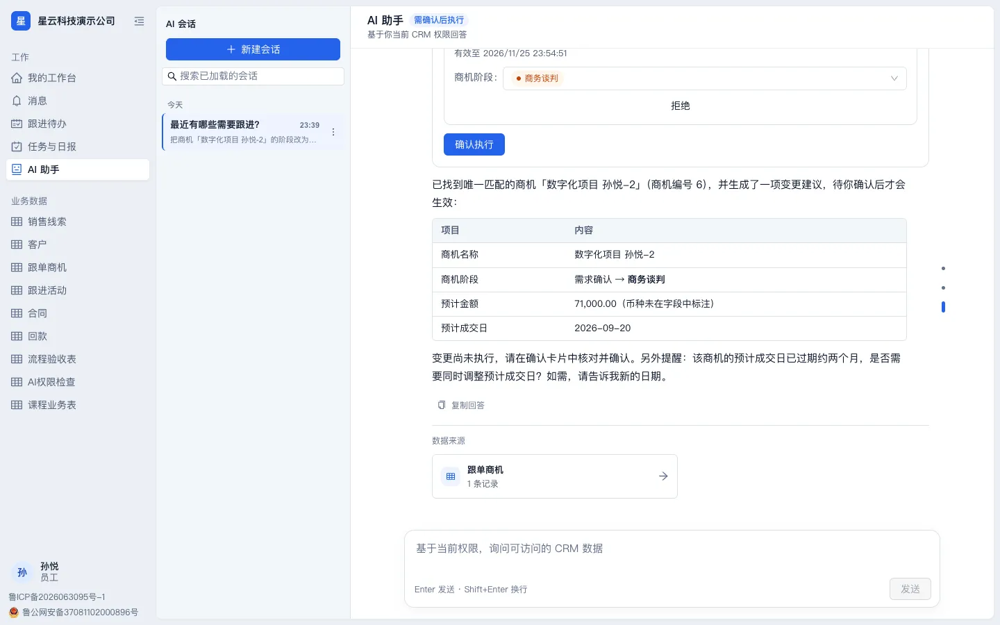

另见：[空状态](./2026-11-25-ui-audit-ai-account/current/ai-assistant-empty-1440.webp) · [含失败的回答](./2026-11-25-ui-audit-ai-account/current/ai-assistant-failures-1440.webp) · [390](./2026-11-25-ui-audit-ai-account/current/ai-assistant-proposal-390.webp)

**主要问题**
- 回答里先出现「10 项成功，9 项失败」和「查询未全部成功，请展开查看原因 / 重试」，销售看到的第一件事是系统出错了。
- 确认卡的结构反过来了：先是可编辑的下拉框和「拒绝」，下面才是说明和一张「项目 / 内容」表；「确认执行」孤零零在卡片外面。
- 回答是长段 Markdown 加表格，没有把「结论」和「依据」分开；「数据来源」卡片在最底部，和回答的关系不明显。
- 会话列表、标题栏、输入框分别是三种灰色和圆角；标题栏的「需确认后执行」标签没有说明指的是什么。

**对标产品怎么做**
- HubSpot Breeze 助手在侧栏里直接针对当前记录做总结和回答。
- Salesforce Agentforce 的自定义动作可以勾选「需要用户确认」，执行前先让用户确认。
- Attio 的 Ask Attio 用聊天回答工作区里的数据，回答围绕具体记录展开。
- 这几家的界面里，用户看到的是回答和要确认的动作，看不到内部每一次查询的成败。

**建议怎么改**
- 回答固定分三段：一句结论，然后是要点或表，最后是来源（可折叠）。工具失败改成「部分数据没查到」的一行注释，明细只在展开时出现。
- 改动卡固定成一个样式：「待确认 · N 项修改」，每项写字段、旧值划线 → 新值，再写依据原话，最后才是「拒绝 / 确认执行」。卡片有 15 分钟有效期的倒计时，过期后变灰。
- 独立页保留做「全局问答」，记录上的提问一律走右侧 AI 栏（5.2）。

### 5.2 侧边助手（列表和记录上的「助手」）

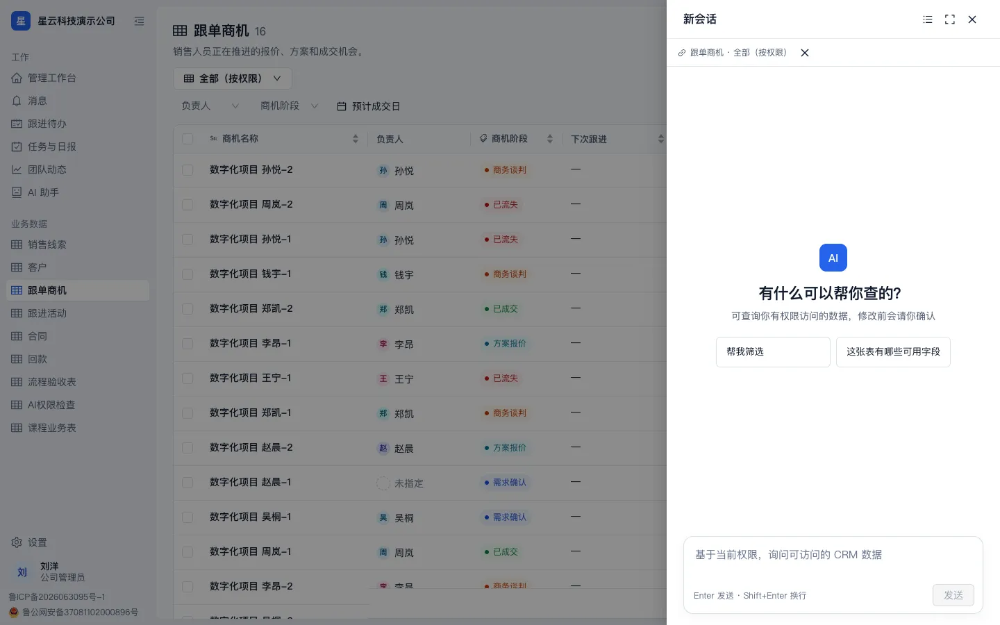

另见：[「只看本月新建的商机」失败](./2026-11-25-ui-audit-ai-account/current/panel-filter-1440.webp)

**主要问题**
- 打开后整页蒙上遮罩，左边的表格看不清也点不了。可是助手的用途正是「看着数据问」。
- 空状态里的「AI」方块图标和 antd 主色按钮，和工作区其他地方都不像。
- 指南里的例子做不到（F4）。

**对标产品怎么做**
- HubSpot Breeze 和 Attio 的助手都从页面侧面打开，不遮挡主内容，并自动带上当前记录或视图作为上下文。

**建议怎么改**
- 改成不加遮罩、可以和页面同时操作的右栏（宽 380–400）。顶部显示「正在查看：跟单商机 · 全部」这类上下文，可以移除。
- 快捷问题按当前页面给出：列表页是「帮我筛选」，记录页是「总结这条 / 帮我写 / 整理沟通」。
- 筛选类回答直接生成筛选条件，并在表格上方显示「AI 生成的条件」，可以继续编辑。

### 5.3 今日建议（员工工作台）

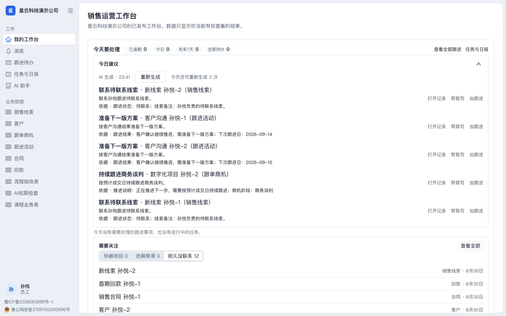

**主要问题**
- 5 条建议用同样的字号排成一列，标题、建议、依据三行几乎一样重；每行右侧的「打开记录 / 帮我写 / 加跟进」三个文字链没有主次。
- 工作台上方「今天要处理 0 / 0 / 0」占了显眼位置，真正有内容的建议被压到下面。
- 「今天还可重新生成 3 次」和生成时间挤在一行小字里。

**对标产品怎么做**
- Pipedrive 的销售助手在首页按条推送「下一步」，每条有一个主要动作。
- Salesforce 的 Einstein 推荐以卡片出现，可以「接受」或「忽略」。

**建议怎么改**
- 每条建议改成「对象图标 + 记录名 + 一句建议」，依据收进第二行灰字，只保留一个主要动作（如「写微信」）和一个「…」菜单。
- 工作台首屏按「今天的建议 → 逾期和今日待办 → 需要关注」排序；没有待办时，把待办折叠成一行。
- 「重新生成」放在标题右侧，用小按钮，并显示剩余次数。

### 5.4 帮我写

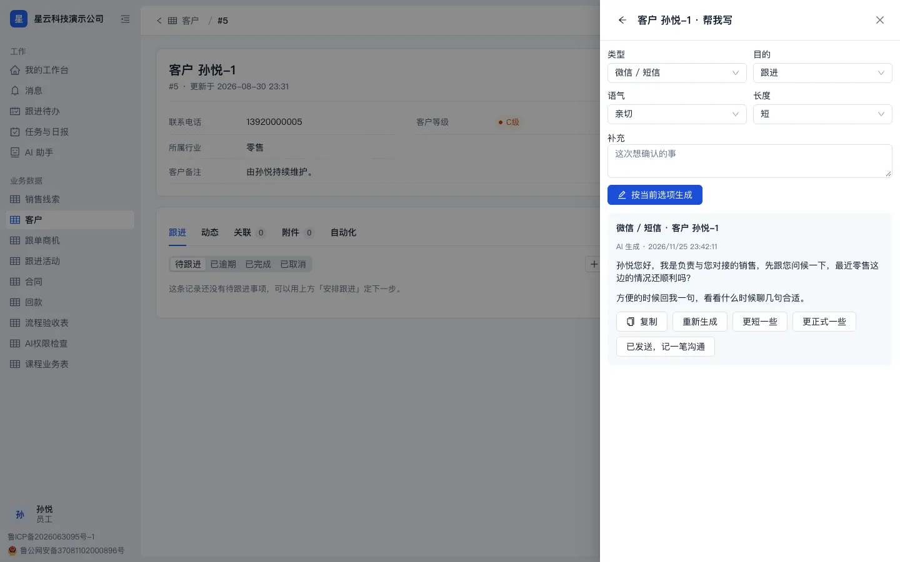

另见：[390](./2026-11-25-ui-audit-ai-account/current/writing-result-390.webp)

**主要问题**
- 开头 4 个下拉框（类型、目的、语气、长度）和一个补充输入框，选完才能生成，第一次用的人要先做 5 个决定。
- 生成结果下面并排 5 个按钮（复制、重新生成、更短一些、更正式一些、已发送记一笔沟通），优先级一样。
- 称呼错误（F11）。

**对标产品怎么做**
- HubSpot、Pipedrive 都在写邮件的地方直接用 AI 起草，草稿就在编辑框里，用户接着改，不需要先填一张选项表。

**建议怎么改**
- 打开就按「微信 · 跟进 · 亲切 · 短」直接生成；4 个选项收成一行，可以随时切换并重新生成。
- 结果放在可编辑的文本框里，主要按钮只有「复制」，次要的是「换个说法」，「更短 / 更正式」做成小标签。
- 「已发送，记一笔沟通」放到复制之后再出现，避免误点。

### 5.5 整理沟通

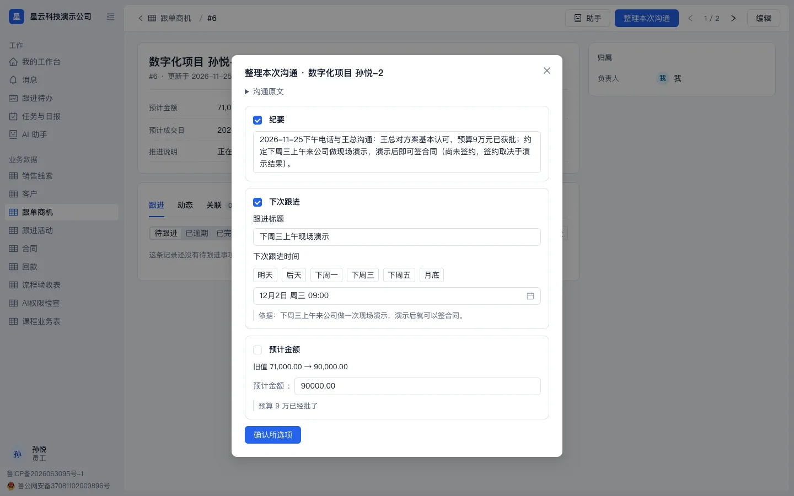

另见：[失败状态](./2026-11-25-ui-audit-ai-account/current/comm-failed-1440.webp) · [390](./2026-11-25-ui-audit-ai-account/current/comm-retry-long-390.webp)

**主要问题**
- 长原文要等约 21 秒才报失败，等待期间只有一个转圈（F2）。
- 成功后，「纪要、下次跟进、预计金额」三块都带复选框和输入框，再加 6 个日期快捷按钮，看起来像一张要填的表，不像 AI 帮你整理好了。
- 预计金额「旧值 71,000.00 → 90,000.00」和下面的输入框重复显示同一个数。

**对标产品怎么做**
- HubSpot、Salesforce 的通话摘要都是先给一段摘要和建议的下一步，再由用户决定要不要建任务；正文是读的，不是填的。

**建议怎么改**
- 和 AI 改动卡用同一个组件：纪要是一段可编辑的正文；字段改动用「旧值划线 → 新值」，默认勾选；下次跟进显示成一行「12 月 2 日 周三 09:00 · 现场演示」，点开才改时间。
- 生成过程分步显示：「读原文 → 提取纪要 → 找字段改动」；超过 10 秒时提示可以先「直接存为纪要」。
- 入口放到记录动态的输入框里（「记一笔沟通，或粘贴聊天原文交给 AI 整理」），不再用居中弹窗。

### 5.6 AI 写日报

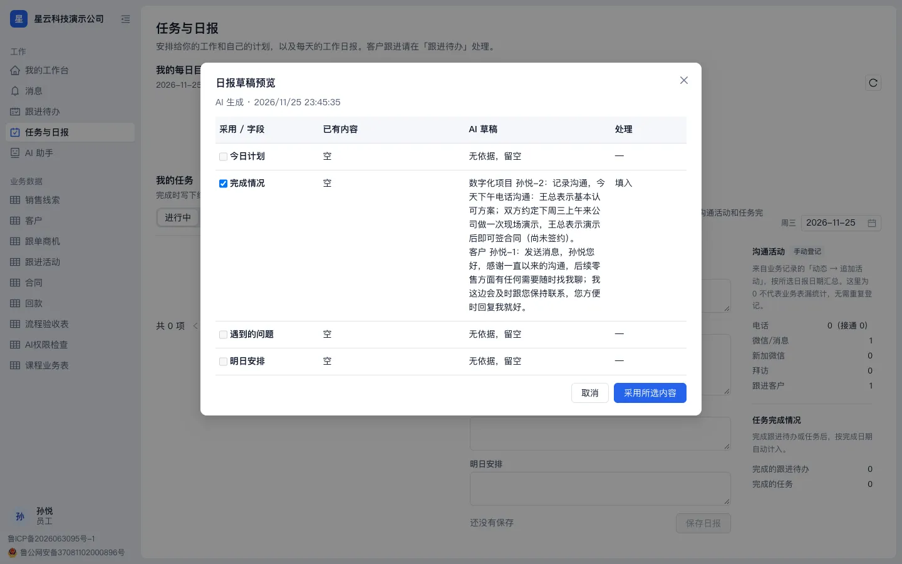

另见：[390](./2026-11-25-ui-audit-ai-account/current/report-draft-result2-390.webp)

**主要问题**
- 四列表格（采用 / 字段 · 已有内容 · AI 草稿 · 处理）放在弹窗里，AI 草稿那一列又窄又长；在 390 宽时更挤。
- 4 项里有 3 项是「无依据，留空」，占的位置和有内容的一项一样大。

**对标产品怎么做**
- Notion AI 写完一段后，提供「替换 / 插入到下方 / 丢弃」，用户在原文旁边直接比较。

**建议怎么改**
- 草稿直接写进日报表单各栏，显示成浅色「AI 草稿」，每栏右上角有「采用 / 丢弃」。
- 没有依据的栏不生成，只在顶部写一句「今天的跟进记录只够写『完成情况』」。

### 5.7 一句话筛选

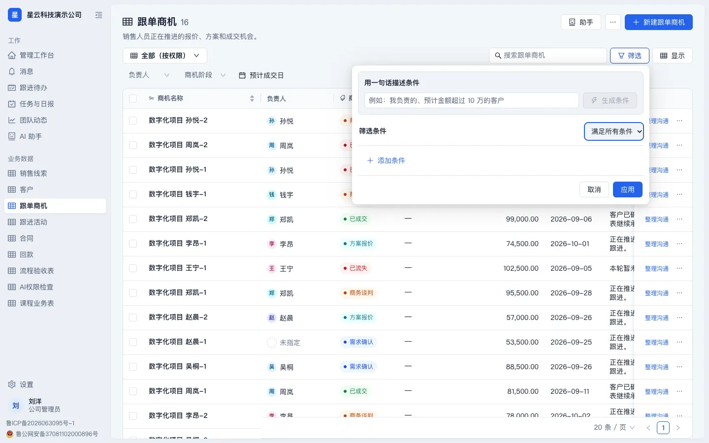

另见：[应用后](./2026-11-25-ui-audit-ai-account/current/filter-result-1440.webp) · [390 超出屏幕](./2026-11-25-ui-audit-ai-account/current/filter-open-390.webp)

**主要问题**
- 「用一句话描述条件」和下面的手动条件是两块独立区域，生成后看不出哪些条件是 AI 加的。
- 弹层在 390 宽时超出屏幕；条件行里的下拉框是两种样式。

**对标产品怎么做**
- Linear 的 AI Filters：在筛选菜单里用自然语言描述要找的内容，AI 套用对应的筛选条件，可以连续追加；没有结果时输入框会重新出现，方便改写。

**建议怎么改**
- 筛选栏只有一个输入框：输入普通文字时，AI 生成条件，并以标签形式加进筛选栏，标签带一个小星标表示「AI 生成」。
- 手机上改成底部弹出的面板。

### 5.8 导入 + AI 帮我对列

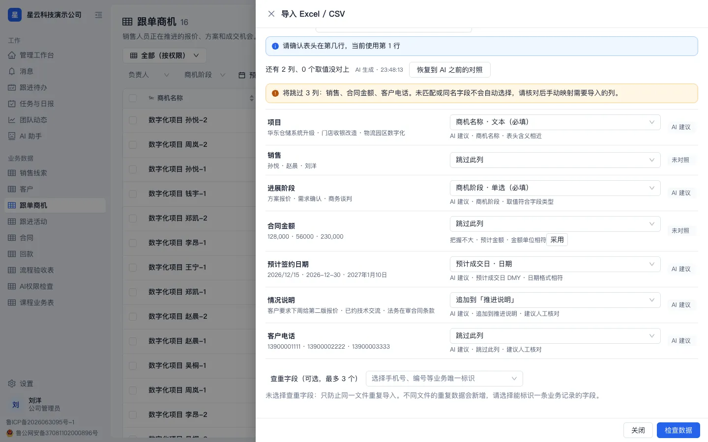

另见：[解析后](./2026-11-25-ui-audit-ai-account/current/import-parsed-1440.webp) · [检查](./2026-11-25-ui-audit-ai-account/current/import-check-1440.webp) · [完成](./2026-11-25-ui-audit-ai-account/current/import-done-1440.webp) · [390](./2026-11-25-ui-audit-ai-account/current/import-assist-result-390.webp) · [导入导出占位页](./2026-11-25-ui-audit-ai-account/current/a-import-1440.webp)

**主要问题**
- 所有步骤（选文件、编码、表头行、负责人、对照、检查、结果）放在同一个长抽屉里，看不出现在走到第几步。
- 顶部同时有蓝色信息条、一行状态文字和橙色警告条；「还有 2 列、0 个取值没对上」和「将跳过 3 列」说的是同一件事。
- 每一列下面的「AI 建议 · 商机名称 · 表头含义相近」小字很难扫读；「未对照」和「AI 建议」标签都是灰色，分不出来。
- 没有负责人列对照，合同金额被跳过（F5）。

**对标产品怎么做**
- HubSpot、Pipedrive 都把导入分成「上传 → 对照 → 检查 → 完成」几步。对照时可以选「不导入这一列」或直接新建字段，负责人可以按成员匹配。Pipedrive 还有导入历史，可以撤销一次导入。
- Attio 自动把列对到属性，没对上的列可以直接新建属性。
- Airtable 的 CSV 导入在对照时显示样例值，可以选择「按某个字段合并」。

**建议怎么改**
- 改成带步骤条的全屏或大抽屉：①上传 ②对照 ③检查 ④完成。对照页做成两栏表：左边是表格列和三个样例值，右边是 CRM 字段。状态只用三种颜色：已对上（绿）、AI 建议（青绿，带星标）、跳过（灰）。
- 顶部只留一句汇总：「7 列：4 列已对上，1 列待确认，2 列跳过」。
- 负责人可以按「整批指定」或「按某列匹配成员」；匹配不上的人在检查页列出来。
- 导入导出页接上导入历史（时间、文件、成功 / 失败数、谁导的），并支持下载失败行。

### 5.9 AI 建表 / AI 补充字段

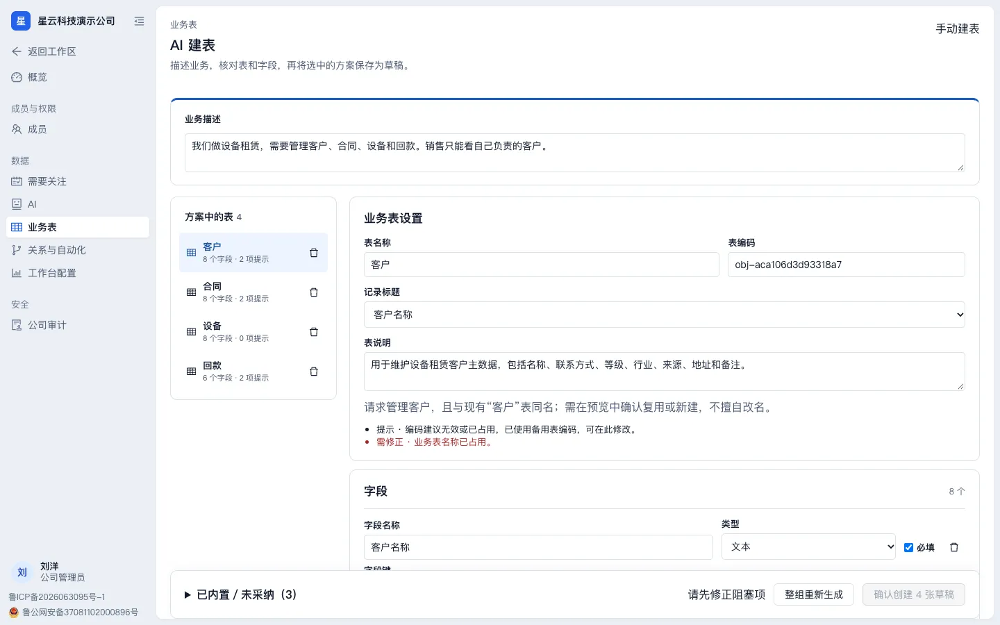

另见：[入口](./2026-11-25-ui-audit-ai-account/current/a-ai-builder-1440.webp) · [超时](./2026-11-25-ui-audit-ai-account/current/builder2-result-1440.webp) · [补充字段](./2026-11-25-ui-audit-ai-account/current/ai-fields-result-1440.webp)

**主要问题**
- 入口页只有一个大输入框和「生成预览」，右上角的「手动建表」是一个没有样式的链接；等待 56–90 秒期间没有任何进度。
- 结果页是三栏表单：表清单、表设置、字段列表；每个字段都是完整的输入行，信息量大，扫不过来。
- 撞名、表编码不可读、选项显示内部 key、刷新后丢失（F3）。

**对标产品怎么做**
- 飞书多维表格的 AI 可以用一句话生成表和字段，结果直接出现在表格里，可以继续改。
- Airtable 的 Cobuilder 可以根据一句描述生成整套应用（表、字段和界面），再由用户调整。

**建议怎么改**
- 生成时逐张显示「正在生成：客户（8 个字段）」，生成完一张就能先看。
- 结果用「表卡片 + 字段预览表」：字段只显示名称、类型图标和是否必填，点开才编辑。
- 和已有表重名时，卡片顶部显示「已有『客户』表：复用并补充 3 个字段 / 另建新表」。
- 方案自动存草稿；表编码用拼音（如 `kehu`），选项显示中文。

### 5.10 公司 AI 设置（额度、用量、记录）

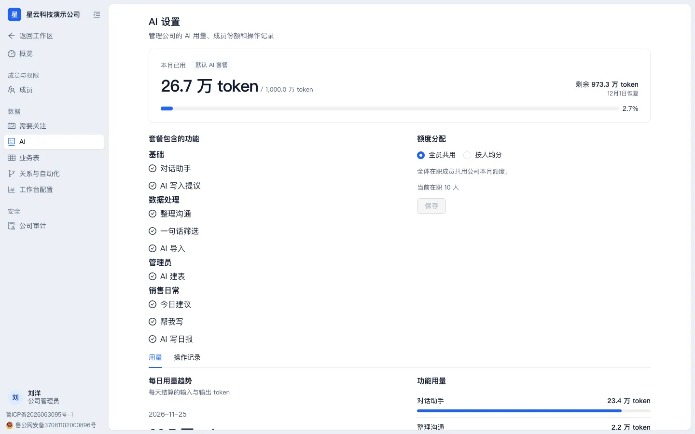

另见：[用量](./2026-11-25-ui-audit-ai-account/current/a-settings-ai-usage-1440.webp) · [记录](./2026-11-25-ui-audit-ai-account/current/a-settings-ai-records-1440.webp) · [390](./2026-11-25-ui-audit-ai-account/current/a-settings-ai-390.webp) · [需要关注](./2026-11-25-ui-audit-ai-account/current/a-daily-brief-1440.webp)

**主要问题**
- 「26.7 万 token」大数字放在第一屏，但管理员更关心的是「够不够用到月底」。
- 套餐包含的功能排成一长列带勾的文字，占了半屏。
- 额度分配（全员共用 / 按人均分）这一块和用量混在一起。
- 「需要关注」设置页只有一个很小的表单，放在大画布中间。

**对标产品怎么做**
- Vercel 的用量页按产品列出用量条，标出「已用 / 额度」和重置日期，超出前提醒。

**建议怎么改**
- 第一屏是一张「本月额度」卡：进度条、剩余天数、按目前速度预计用到哪天。下面是按功能分的用量条（对话助手 23.4 万最显眼）。
- 「包含的功能」收成一行标签，或者放在「套餐」页签里。
- 额度分配和操作记录各自做成页签。
- 「需要关注」并进「设置 · 工作台」，用一张规则卡片说明「多久没联系提醒」。

### 5.11 平台 · AI 模型

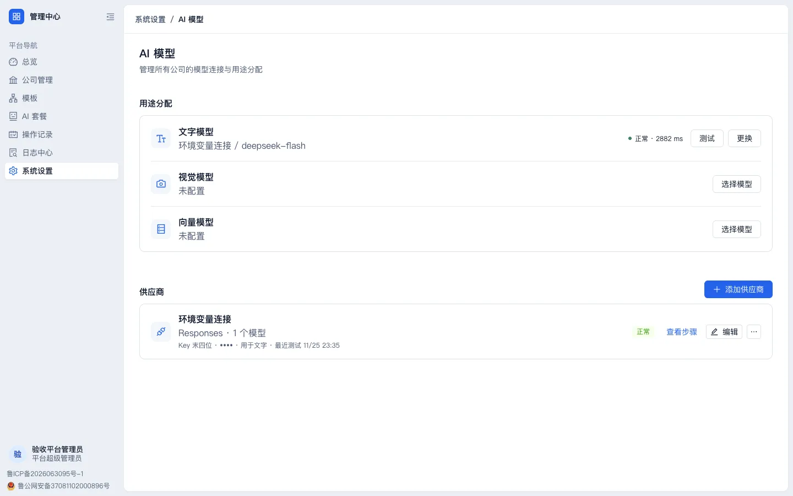

另见：[转换弹窗](./2026-11-25-ui-audit-ai-account/current/p-ai-models-convert-dialog-1440.webp) · [测试结果](./2026-11-25-ui-audit-ai-account/current/p-ai-models-test-result-1440.webp) · [初始](./2026-11-25-ui-audit-ai-account/current/p-ai-models-1440.webp) · [390](./2026-11-25-ui-audit-ai-account/current/p-ai-models-390.webp)

**主要问题**
- 「用途分配」（文字、视觉、向量）和「供应商」上下两块，关系不直观；视觉模型和向量模型「未配置」看起来像出错了。
- 转换弹窗有 3 步，但第 3 步要手填上下文长度、最大输出和计价，测试按钮灰着又不说为什么（F7）。
- 测试结果一长行灰字：「测试通过 · 2845 ms 文字回复 607 ms 工具调用…」。

**对标产品怎么做**
- Linear、Vercel 的设置页都是一张卡对应一个对象：名称、状态点、最近一次检查、一个主要操作。

**建议怎么改**
- 每个用途一张卡：文字模型「deepseek-flash · 正常 · 2.9 s · 11/25 23:35 测试」；未配置的显示成「可选：配置后可识别图片」这类中性说明。
- 测试结果分两行显示：文字回复、工具调用，各带一个对勾和耗时。
- 测试按钮灰着时，按钮下方列出还缺的项目。

### 5.12 平台 · AI 套餐

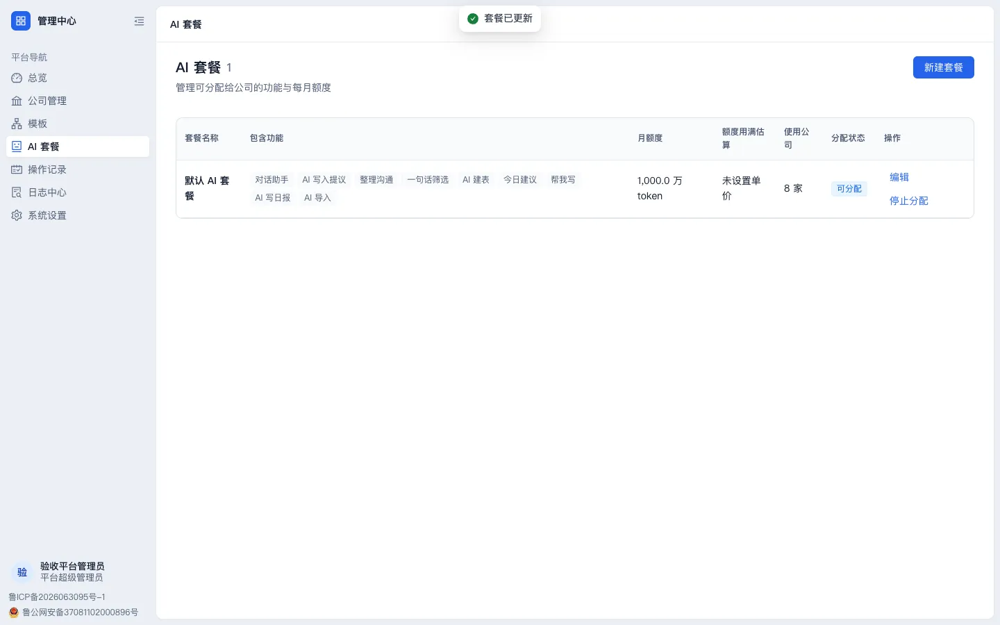

另见：[编辑](./2026-11-25-ui-audit-ai-account/current/p-ai-plan-edit-1440.webp) · [390](./2026-11-25-ui-audit-ai-account/current/p-ai-plans-390.webp)

**主要问题**
- 一行表格里塞了 9 个功能标签，会换成两三行；「额度用满估算：未设置单价」看不出是什么意思。
- 编辑弹窗里的功能分组（基础、数据处理、管理员、销售日常）是对的，但复选框排列很密。

**对标产品怎么做**
- 常见的套餐页用「功能 × 套餐」矩阵：功能按组纵向排，套餐横向排，打勾表示包含。

**建议怎么改**
- 套餐只有一两个时，改成卡片：名称、月额度、在用公司数、包含 9 / 9 个功能（可展开）。
- 编辑时按组显示功能，每组一行开关，并说明这个功能会调用哪种模型。

### 5.13 平台 · 系统设置与测试邮件

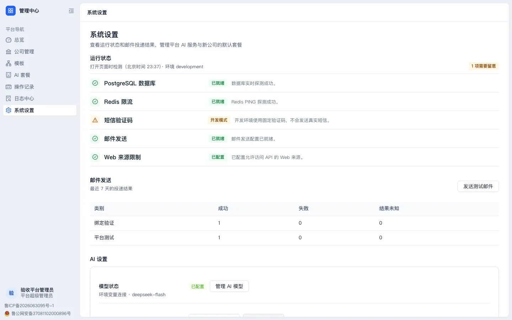

另见：[测试邮件](./2026-11-25-ui-audit-ai-account/current/mail-test-1440.webp)

**主要问题**
- 邮件、AI、默认套餐、紧急开关都在一个长页面里，没有目录。
- 投递统计是一张小表，「结果未知」没有解释。

**建议怎么改**
- 左侧小目录：邮件、AI、默认套餐、紧急开关。
- 邮件卡片显示发件地址、最近 7 天的成功率，以及「发送测试邮件」按钮。
- 「结果未知」加一句说明（例如：已交给邮件服务商，未收到回执）。

### 5.14 个人资料与头像

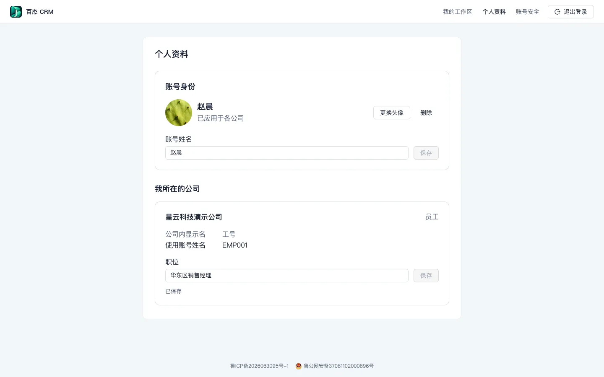

另见：[初始](./2026-11-25-ui-audit-ai-account/current/profile-initial-1440.webp) · [头像裁剪](./2026-11-25-ui-audit-ai-account/current/profile-avatar-crop-1440.webp) · [裁剪 390](./2026-11-25-ui-audit-ai-account/current/profile-avatar-crop-390.webp)

**主要问题**
- 头像裁剪是方形预览加三个原生滑块（缩放、水平位置、垂直位置），看不到圆形头像最后的样子。
- 「账号身份」和「我所在的公司」是两张卡，各有一个「保存」，用户不确定要点几次。
- 外壳和工作区不同（U2）。

**对标产品怎么做**
- GitHub 上传头像后弹出裁剪框，可以直接在图上拖动选区。
- Linear 的个人资料是一列：头像、姓名、用户名，改完统一保存。

**建议怎么改**
- 裁剪框显示圆形遮罩，可以直接拖动图片，只留一个缩放滑块；旁边同时预览大小两个尺寸的圆形头像。
- 页面分两组：「账号」（头像、姓名，对所有公司生效）和「在星云科技演示公司」（显示名、工号、职位）。每组改动后，底部出现「保存 / 取消」条。
- 放进和工作区相同的设置侧栏（方向 A 的样稿）。

### 5.15 账号安全

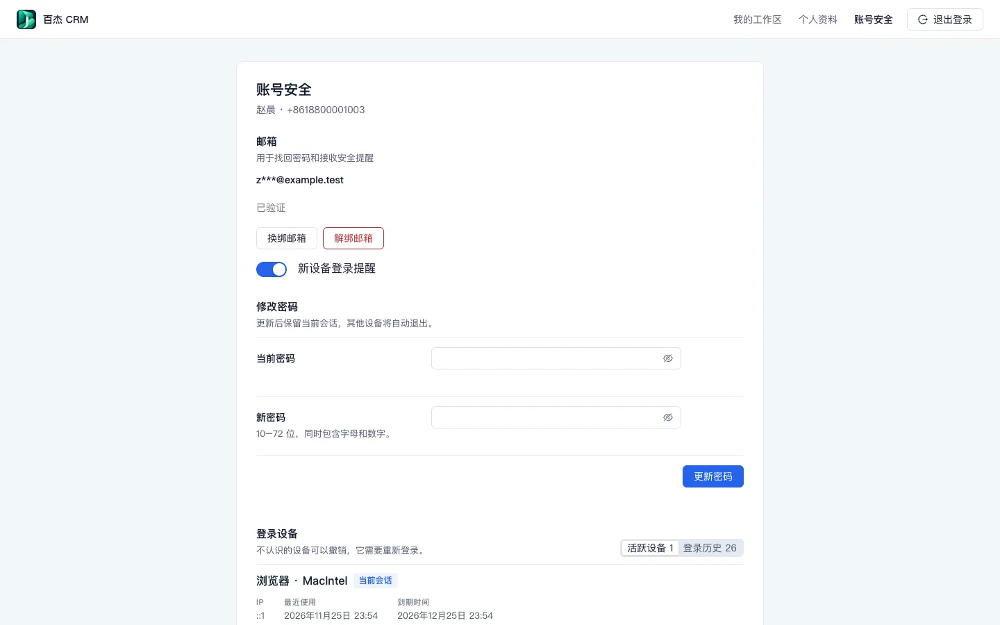

另见：[390](./2026-11-25-ui-audit-ai-account/current/security-final-390.webp) · [绑定表单](./2026-11-25-ui-audit-ai-account/current/zhao-security-bind-form-1440.webp) · [验证码已发](./2026-11-25-ui-audit-ai-account/current/zhao-security-code-sent-1440.webp) · [换绑](./2026-11-25-ui-audit-ai-account/current/security-change-form-1440.webp) · [设备](./2026-11-25-ui-audit-ai-account/current/security-sessions-1440.webp)

**主要问题**
- 修改密码的两个输入框和「更新密码」一直展开，占了半屏。
- 邮箱、新设备提醒、密码、设备排成一列，没有分组；「已验证」是一行灰字，不像状态标签。
- 「解绑邮箱」用红色描边按钮，和「换绑邮箱」并排，太显眼。
- 手机号显示成 `+8618800001003`，没有空格也没有打码。
- 登录设备显示「浏览器 · MacIntel」「::1」，用户认不出是哪台设备。

**对标产品怎么做**
- GitHub 和 Linear 都在设置里列出登录会话：设备、地点、最近活动，每条可以单独撤销。
- 飞书账号安全中心把手机、邮箱、密码、登录设备分组列出，每行右侧是当前值和箭头。
- Vercel 的设置页一张卡一件事，主要操作放在卡片右侧或底部。

**建议怎么改**
- 分两组卡片：「登录与验证」（手机号、邮箱 + 已验证标签、密码、新设备提醒开关）和「登录设备」。
- 修改密码改成按钮，点开才出现表单（行内展开或弹窗）。「解绑邮箱」收进「…」菜单。
- 手机号显示成 `+86 188****1003`。设备名用「Chrome · macOS」，地点用「上海 · 电信」；「本机」用标签标出。登录历史改成一个链接：「查看最近 90 天登录记录」。
- 样稿见方向 A 的下半屏。

### 5.16 登录与找回密码

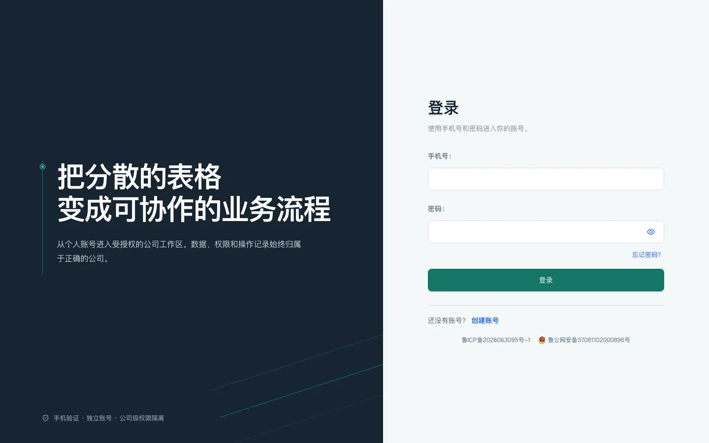

另见：[邮箱找回 · 输入验证码](./2026-11-25-ui-audit-ai-account/current/auth-reset-email-code-1440.webp) · [重置完成后回到登录页](./2026-11-25-ui-audit-ai-account/current/auth-reset-email-done-1440.webp) · [390](./2026-11-25-ui-audit-ai-account/current/auth-reset-email-390.webp)

**主要问题**
- 登录页用青绿色，进了工作区变成蓝色（U1）。
- 重置成功后没有提示（F8）。
- 左侧大标题「把分散的表格变成可协作的业务流程」和右侧表单之间缺少产品画面，像模板页。

**建议怎么改**
- 统一成方向 A 的青绿强调色。
- 左侧换成一张真实产品截图（商机页 + AI 栏），表单保持单列。
- 重置成功后回到登录页，顶部显示绿色提示，并预填手机号。

### 5.17 邮件模板

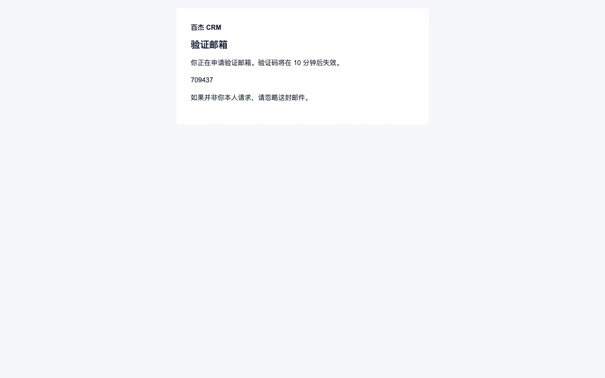

另见：[新设备登录](./2026-11-25-ui-audit-ai-account/current/mail-new-device-1440.webp) · [邮箱已更换](./2026-11-25-ui-audit-ai-account/current/mail-email-changed-1440.webp) · [找回密码](./2026-11-25-ui-audit-ai-account/current/mail-reset-1440.webp) · [测试邮件](./2026-11-25-ui-audit-ai-account/current/mail-test-1440.webp)

**主要问题**
- 没有 logo，验证码只是加粗的一行；退订和设置链接是默认的蓝色下划线。
- 新设备邮件里没有「如果不是你，怎么办」的按钮。

**对标产品怎么做**
- GitHub、Linear、Vercel 的安全邮件都是：logo、一句标题、等宽大号验证码（或一个主按钮）、设备和地点信息、「不是你本人？」的处理链接，页脚说明为什么收到这封邮件。

**建议怎么改**
- 统一一个模板：顶部 logo；标题一行；验证码用 28px 等宽字体放在浅底块里；新设备邮件列出设备、地点、时间，并给一个「不是我，立即退出这台设备」按钮；页脚写发件原因和设置入口。
- 颜色只用品牌青绿和灰；按钮用表格布局，兼容各家邮箱客户端。

---

## 6. 三个整体方向

对比页：[style-explorer.html](./2026-11-25-ui-audit-ai-account/style-explorer.html)。每个方向上半屏是「商机详情 + AI」，下半屏是「账号安全」；第一格是现在的实拍（AI 助手确认卡 + 账号安全）。三个方向用的是同一条商机、同一句 AI 指令和同一份账号数据，只有结构和视觉不同。

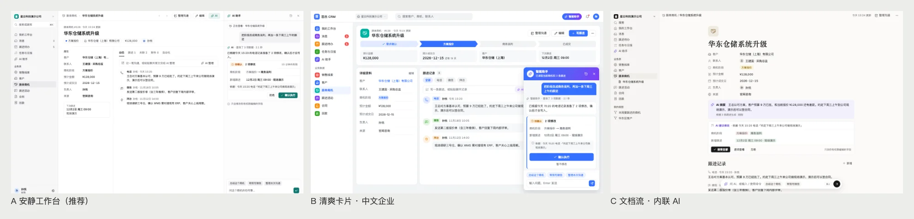

| | A 安静工作台（推荐） | B 清爽卡片 · 中文企业 | C 文档流 · 内联 AI |
| --- | --- | --- | --- |
| 参考 | Attio、Linear | 飞书、纷享销客、HubSpot | Notion、Airtable |
| 一句话 | 记录是主角，AI 是同一屏右侧可收起的同事 | 灰底白卡、阶段路径、数字卡，AI 是右下角的浮窗 | 一条商机就是一页文档，AI 摘要和修改建议直接写在页面里 |
| 颜色 | 中性灰白 + logo 青绿 `#0F766E`，统一品牌色 | 飞书蓝 `#3370FF` + 彩色图标块 | 暖白纸面 + 黑色主按钮，紫色只给 AI |
| AI 的位置 | 右侧 392px 栏，不加遮罩，带当前记录上下文 | 浮窗，渐变标题栏，大「确认执行」 | 页面里的「AI 建议修改」块 + 底部命令栏 |
| 账号中心 | 和工作区共用侧栏，两组卡片 | 飞书账号中心式：顶部「已完成 3/3 项」，下面分组列表 | 盖在工作区上的设置弹窗，设备用表格 |
| 优点 | 信息密、安静，适合每天打开几十次；和现有侧栏、侧边助手的结构最接近，改造风险低 | 国内客户最熟悉，演示时一眼看懂进度 | 辨识度最高，长文本（跟进、纪要）读起来最舒服 |
| 风险 | 需要克制，否则会显得「太素」；需要好的图标和数字排版 | 卡片多、颜色多，页面多了容易花；和你之前定的参考方向不一致 | 表格、列表这类高密度页面要另做一套，改造量最大 |

样稿（1440×900）：

| | 商机详情 + AI | 账号安全 |
| --- | --- | --- |
| A | 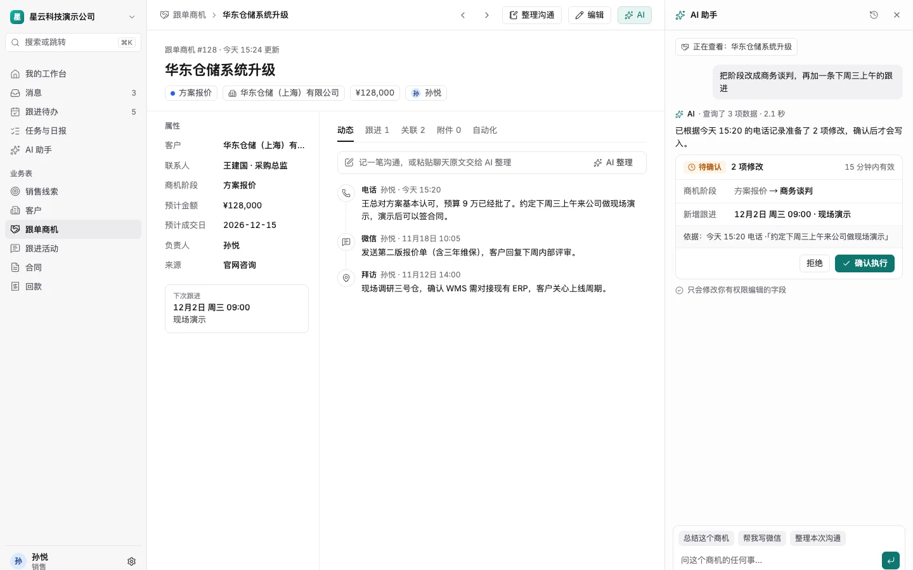 | 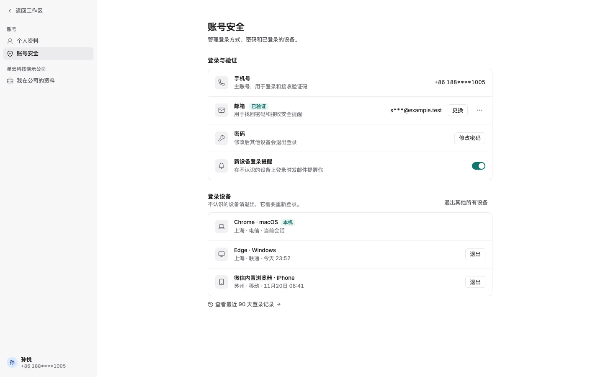 |
| B | 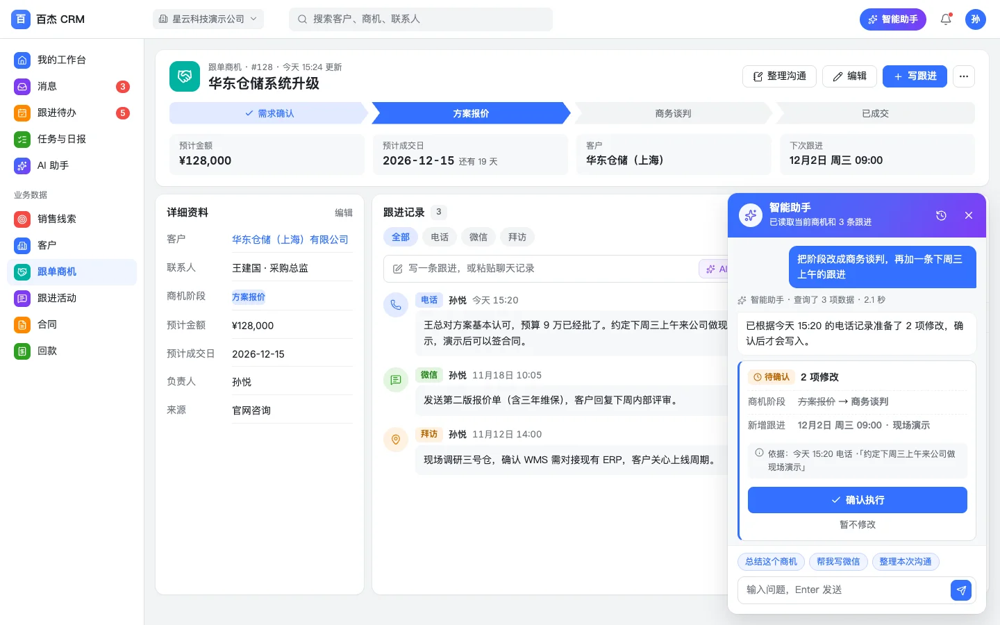 | 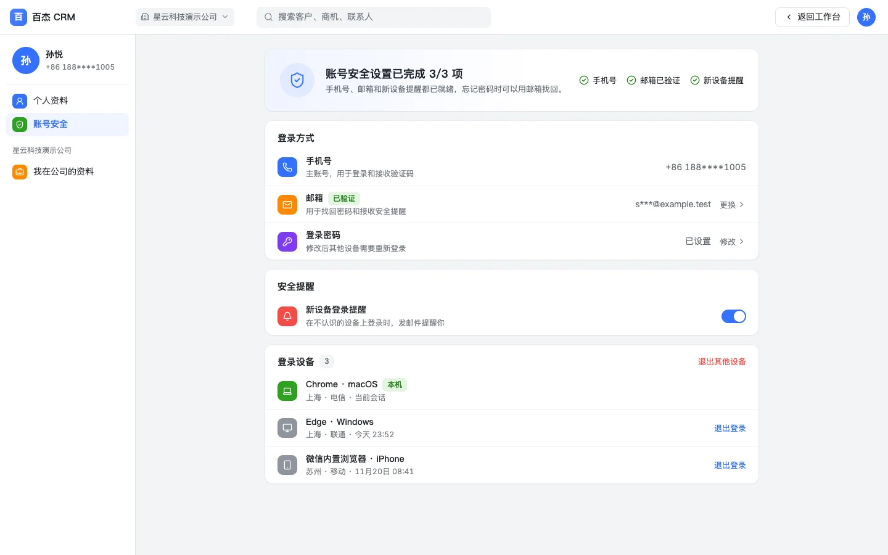 |
| C | 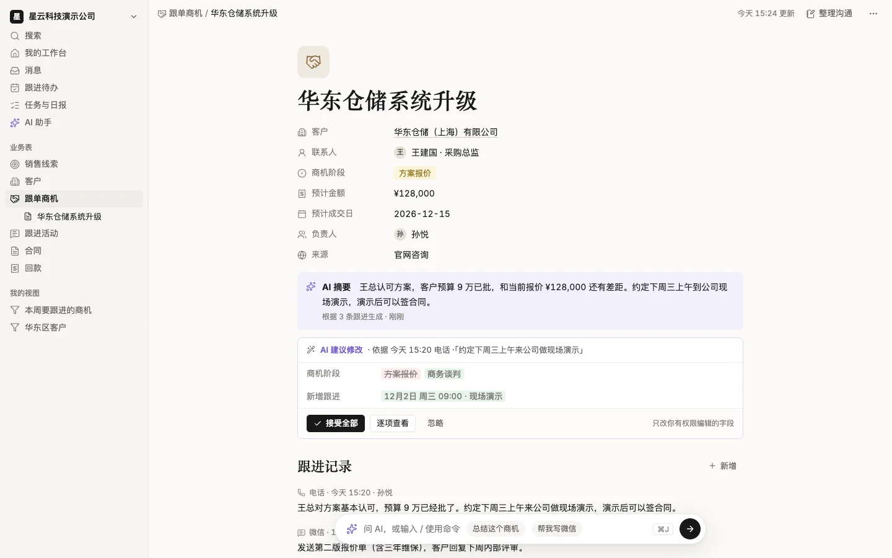 | 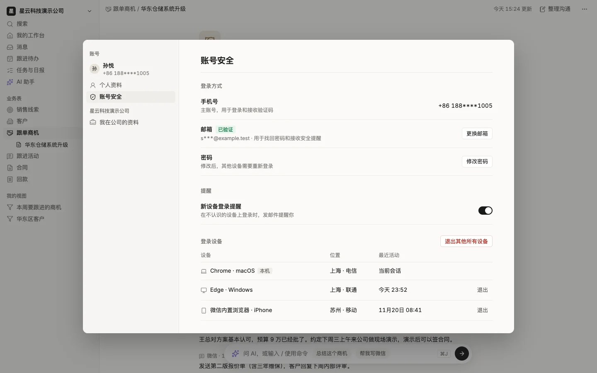 |

**为什么推荐 A**
1. 它和你之前定的参考（Attio、Linear、Notion、Airtable）一致，而且在高密度的列表和表格页上也成立。
2. 它用 logo 的青绿做唯一强调色，一次解决品牌色分裂（U1）。
3. 它和现在的结构最接近：侧栏导航和侧边助手都已经有了，只是把助手的遮罩去掉、放进记录页右侧，所以改造风险最低。
4. 它把所有 AI 改动统一成一张「待确认」卡，正好收拢 U3 和 U5。

样稿只做了桌面端。选定方向后，第二阶段会补齐 1280 和 390 宽、空状态、加载和错误状态。

---

## 7. 第二阶段（方向 A，已完成一轮独立评审）

**已经定下的事（用户确认，2026-11-26）**
- 方向：A「安静工作台」。
- 实现：由 Claude 在本分支 `claude/ui-redesign-ai-account` 直接实现。
- 基线：先合入 Codex 本地最新的 `codex/account-profile-email`（`48068ad`，合并提交 `56e7abd`）再开工。Codex 的 PR 1 开出来后，本分支再跟一次。

**进度**

| 步骤 | 提交 | 内容 |
|---|---|---|
| 1 设计令牌 | `009d9e3` | 两套 antd 主题合成一套：青绿 `#167568` 唯一强调色、锌灰中性色、AI 专用紫色；数字用 Inter 等宽显示。已写进 [交互与样式约束 V3](./04-交互与样式约束-v3-final.md) 第 3 节 |
| 2–3 外壳与 AI 组件 | `96d85a9` `b53a34d` | 侧边助手改成不加遮罩的停靠栏；记录详情按方向 A 重排；「待确认」改动卡统一；今日建议、帮我写、日报草稿、整理沟通用同一套 AI 卡片 |
| 5 导入与后台 AI 页 | `c98bf2a` | 导入向导分成带编号的步骤、拖入文件区、列对照表头；AI 建表结果页的字段表格和问题清单；AI 设置、套餐、模型页统一样式 |
| 4 账号中心 | `c1d571d` | 账号中心改用工作区同一套侧栏；账号安全分「登录与验证」「登录设备」两组，修改密码默认收起；邮箱操作收进一行；头像改成圆形裁剪（拖动、键盘、缩放滑块、两档预览）；重置密码后回登录页提示 |
| 6 邮件模板 | `1c3041d` | 所有账号邮件一套模板：品牌、标题、验证码块或信息行、一个按钮、页脚说明 |
| 规范 | `1053c4c` | 方向 A 的颜色、尺寸和 AI 标记写进交互与样式约束 V3 |
| 4 登录与找回密码 | `6fc14c0` | 左侧换成浅灰底上的工作台画面（商机、最近跟进、AI 栏和一张「待确认」卡），用产品令牌绘制、不含真实数据；右侧白底单列表单，40px 控件；1100px 以下只留品牌和表单 |
| 自查 | `2de3d1a` | 走查记录详情、AI 栏、待确认卡、账号中心和后台 AI 页；只有一个提问时不再显示提问定位条 |
| 评审修正 · AI | `650c847` | 对话贴底不再跳动、「回到最新」不再盖字；停靠栏确认后同屏记录即时刷新；提议卡标题与状态一致，过期卡可「按最新数据重新提议」；同一字段只出现一次并标出「原为」；AI 写的内容统一用紫色「AI 生成 / AI 提议 / AI 理由」标记 |
| 评审修正 · 账号 | `db7eb71` | 改密码时当前密码输错，报错落在该字段上；换绑邮箱中途取消或刷新后能接着填验证码，发送受限时说明限制，成功后写出新地址 |
| 评审修正 · 导入与细节 | `41f34db` | 导入检查和导入结果放进主区域并自动滚到那里，可导入 0 行时说明原因，全部导入后按钮换成「完成」；AI 建表的问题标在表名称字段下；登录页去掉重复报错和口号；用量图纵轴从 0 开始；平台与公司页状态、套餐标签统一；AI 会话列两条左对齐线；若干文案 |
| 主 Agent 验证后补修 | `fcbb573` `7388045` | 刷新后换绑邮箱提示重新输入密码；导入完成后仍标出 AI 对照；AI 空状态与输入框对齐；窄卡片里快捷日期排成两行三个 |

每一步都在 1440、1280、390 三个宽度截图（本机 `.oil-ui/ai-account-audit/p2/`，不提交），Web 全量测试、类型检查和 lint 通过后才提交。所有操作只在复制库 `crm_ui_review` 上进行，邮件只发到本机 Mailpit。

**独立评审（第一轮，2026-11-26）**

三个评审者分别负责：视觉盲审（只看 39 张截图，不看代码），UX 走查 A（导入、AI 助手），UX 走查 B（登录找回、改密码、绑邮箱、登录设备）。

- 视觉评分 **7 / 10**，没有触发否决项。扣分主要在四处：提议卡状态和正文矛盾，AI 标记不统一，导入和建表的提示堆在顶部，对话区浮钮盖字。离 8 分还差三处：AI 标记统一，三种状态在缩略图里分得清、不切字、左锚线收齐，「确认 → 已执行」的过渡。
- UX 走查的主路径都能走完，卡住或犹豫的地方有三类：停靠栏确认后记录详情不刷新，换绑邮箱中途离开后验证码没处填，改密码报错离字段太远。
- 以上问题和 P2 细节都已修完，见上表。评审要求“结构重做”的问题一个也没有，因此按约定没有再派复核。
- 评审里的「Key 末四位 · ••••」是截图脚本为了不泄露密钥做的遮挡，产品里显示的是真实末四位，所以没有改。

**主 Agent 自查验证（真实页面，复制库）**
- 改密码（赵晨）：输错当前密码 → 字段内报错、焦点回到该字段、新密码保留；改成功后新密码能登录、旧密码失效；已改回 `Demo@123456`。
- 换绑邮箱（赵晨）：发码后刷新 → 验证码框和新邮箱保留、密码不保留并提示重输；错误验证码有提示；成功后写出新地址，刷新读回一致。赵晨的邮箱已换回评审前的 `zhao.chen@example.test`。
- 导入（刘洋，跟单商机）：缺必填列时点名缺哪一列并禁止检查；正常文件检查 → 导入 2 行 → 刷新列表读回。复制库因此新增两条「复核导入-…」商机，没有删除任何数据。

**这一轮没有改的**
- 一句话里同时要求记沟通和改字段时，字段修改被漏掉：这是模型提议逻辑，不属于 UI。
- AI 对列的理由、今日建议的内容质量：模型输出问题。
- 导入入口藏在「···」菜单里，重新选文件会清空对照：需要产品决定入口和保留规则。
- 停靠栏会沿用另一条记录的对话；个人资料改了没保存就刷新不提示；被挤下线的设备在登录页看不到原因：涉及会话和账号流程，单独开任务更稳妥。
- 平台页头的面包屑和大标题看起来重复，但所有平台页都这样，属于外壳规则，没有单独改。
- 第 3 节的功能问题（F1–F12）不属于 UI 改造，仍需单独开任务；F1–F3 最好在对外演示前修掉。

---

## 8. 参考来源

- HubSpot 导入工具：<https://knowledge.hubspot.com/import-and-export/understand-the-import-tool>
- HubSpot Breeze 助手：<https://knowledge.hubspot.com/ai/summarize-and-review-data-with-breeze-assistant>
- Salesforce 自定义动作与用户确认：<https://help.salesforce.com/s/articleView?id=ai.copilot_actions_custom.htm>
- Attio 导入：<https://attio.com/help/academy/introduction/importing>
- Ask Attio：<https://attio.com/help/reference/attio-ai/ask-attio/chat-with-ask-attio>
- Pipedrive 表格导入：<https://support.pipedrive.com/en/article/importing-data-into-pipedrive-with-spreadsheets>
- Pipedrive AI 功能综述：<https://www.eesel.ai/blog/pipedrive-ai>
- Airtable CSV 导入：<https://support.airtable.com/articles/3067164948-csv-import-extension>
- 纷享销客 AI：<https://www.fxiaoke.com/crm/information-93632.html>
- 销售易 AI：<https://www.xiaoshouyi.com/about-us/gsdt/100698.html>
- 飞书多维表格 AI：<https://www.feishu.cn/marketing/base_ai>
- 飞书账号安全中心：<https://www.feishu.cn/hc/zh-CN/articles/381170146224>
- Linear 安全与访问：<https://linear.app/docs/security-and-access>
- GitHub 会话管理：<https://docs.github.com/en/authentication/keeping-your-account-and-data-secure/viewing-and-managing-your-sessions>
- Linear AI Filters：<https://linear.app/changelog/2023-06-01-ai-filters>

---

## 附：复现与文件

- 样稿源码：`2026-11-25-ui-audit-ai-account/directions/*.mjs`。运行 `node build.mjs` 会生成各方向的 HTML；对比页由 `manifest.json` 加 oil-ui-pro 的 `build_explorer.py` 生成。
- 走查脚本、原始截图、日志、本地 DNS 预加载脚本都在 `.oil-ui/ai-account-audit/`，这个目录已被 gitignore，不提交。
- 本地服务：Web `http://localhost:3100`，API `http://localhost:3101`，Mailpit `http://localhost:8025`，数据库 `crm_ui_review`。
