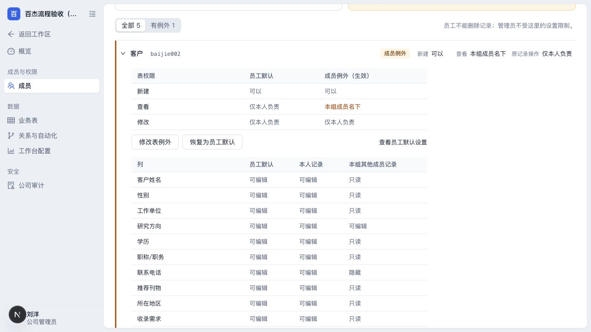

# 组长查看和修改组员记录的列权限

本功能在本地开发验收，本轮尚未部署到服务器。

## 两套权限分别管什么

成员仍然是员工角色。公司管理员先把他设为小组组长，再逐张业务表授权“本组成员名下”。

| 设置 | 影响范围 |
| --- | --- |
| 本人记录的列权限 | 组长自己负责的记录，沿用原来的成员列权限 |
| 本组其他成员记录的列权限 | 当前同组其他员工负责的记录，不影响这些员工本人操作 |
| 可以修改记录 | 修改总开关；关闭后，组员列即使配置为可编辑也不能修改 |
| 原记录操作范围 | 原来的整条记录操作边界；组员列可编辑不会额外开放负责人变更、流程确认或附件管理 |

例如，客户表可设成：组长看自己的客户时能编辑电话；看组员客户时隐藏电话、只读客户姓名，但可编辑研究方向。这些设置只影响该组长，不改变普通员工的权限，也不改变业务表发布的员工默认。

## 管理员设置

1. 管理设置 → 成员 → 小组，创建小组、添加员工并指定组长。
2. 打开组长的“查看和设置”权限页面，展开需要授权的业务表。
3. 开启“可以查看记录”，将查看范围设为“本组成员名下”。需要允许修改组员某些列时，同时开启“可以修改记录”。
4. 在“设置组员列权限”中，逐列选择“可编辑”“只读”“隐藏”，保存后立即生效，无需重新发布业务表。
5. “设置列权限”仍用于原成员列权限。两种设置分别保存，不应为开放组员某一列而把整个修改范围改成“全部记录”。

“可编辑”仅允许修改该列的数据值；“只读”能看不能改；“隐藏”不向该组长返回组员记录的该列内容。系统字段不能通过这个入口改为可编辑。

如果修改某列会触发跨表自动化，而组长没有执行该规则所需的原记录操作权限，系统会拒绝整次修改并说明原因。管理员应检查该规则及原记录操作范围；系统不会只保存一部分字段，也不会因为某列可编辑就额外开放整条记录的操作。

标题列沿用系统现有的记录可读性规则：把组员记录的标题列隐藏，会使这些组员记录不可见，而不只是去掉一列表格文字。界面会提示这个影响。

## 组长验证

1. 在业务表中同时查看自己和组员的记录，核对不同记录的字段权限。
2. 打开组员记录：可编辑列可修改并保存，只读列不能编辑，隐藏列不显示。
3. 打开自己的记录：原来的可见列、可编辑列保持原样。
4. 导出时，隐藏的组员字段值不能出现在文件中；自己有权读取的字段仍按实际权限处理。
5. 搜索、筛选、排序、汇总和 AI 查询不能利用隐藏列推断组员的数据。混合查看本人和组员记录时，相关查询控件只提供该范围共同可见的字段。

## 调整与撤销

- 关闭“可以修改记录”后，后续修改请求立即被拒绝；刷新页面后应显示新的只读状态。
- 组员移出小组、更换组长或停用组长后，系统按当前成员关系判断权限，不沿用旧的组员名单。
- 停用字段或业务表后，组员列授权不能重新开放它。
- 未配置独立组员列权限时保持原有行为，不会自动扩大权限。启用后，新增加或未单独设置的列按原可见性只读或隐藏，管理员必须明确设置“可编辑”才会新增修改能力。
- 恢复组员列的原规则时，重新使用原成员列权限和原记录修改范围；已有“全部记录”修改授权仍按原设置执行。

启用独立组员列规则的员工使用 AI 时，历史回答也会检查权限变化。如果成员权限、分组、业务表发布或记录归属等发生变化，系统可能隐藏旧回答并提示重新提问，避免旧回答继续带出当前无权读取的信息。历史原文不会被删除；普通字段内容更新不会因此隐藏历史。由于旧回答没有完整的逐字段来源，本轮采用保守判断，同公司其他权限调整也可能让受保护的旧回答需要重新查询。未使用该规则的普通员工和管理员会话不因此统一清空。

本次功能不新增业务记录、不调整负责人、不自动分组，也不自动给任何组长授权。

## 本地验收示例

本轮使用独立的演示数据库，以刘洋作为管理员、赵晨作为组长、孙悦作为组员，创建两条虚构客户记录进行验收。管理员给赵晨设置：组员的客户姓名和工作单位只读，联系电话隐藏，研究方向可编辑。网页保存、刷新和双方查看已验证；不涉及服务器上的公司配置。

