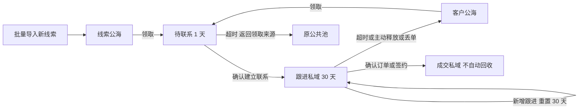

# 通用公共池流转方案与客户表配置

日期：2026-10-18。状态：已实现并完成本地验收；尚未部署服务器。

本轮实现未指定负责人筛选、每表独立的多阶段公共池、有效跟进续期、关联正式状态触发保护。保留旧模式，旧记录不自动归类；所有变更仅在本地验证。

## 1. 先说清楚它是什么

每张业务表可单独开启公共池。客户、销售渠道、合作资源等都可以使用同一套“领取—持有—跟进—释放—回收”能力；无需给每种业务重做一套公海。

同一张客户表中只有一份客户记录，领取、回收只是改变归属和阶段，记录编号、附件、跟进历史及订单关联保留。左侧仍只有“客户”这个业务表入口，池作为表内视图切换。销售渠道另有自己的记录和公共池，不与客户池混在一起。

“未指定负责人”仅表示负责人为空。“公共池”表示明确允许领取。历史未指定记录继续等待管理员安排，不因本次筛选或以后启用公海自动公开。

## 2. 现有能力与本方案的区别

现有系统已经支持按业务表开启公共池、员工领取、手动释放、管理员分配、固定持有期限到期回收；权限仍按表和字段控制。

启用分阶段流转后，增加两个公共阶段、待联系限期、跟进自动续期、成交保护和按来源回池。未开启的业务表沿用原逻辑。普通内容编辑不重置期限，有内容的记录活动才可续期。

实现时沿用现有记录、负责人、公共池标记、到期时间、活动和审计能力。补充阶段和必要的流转时间、来源、原因等系统信息，不让管理员手工维护两套互相矛盾的“负责人”“是否公海”业务字段。物理存储的最小迁移在开发时确定；不建立四张重复客户业务表。

## 3. 已确定的规则与建议默认值

| 事项 | 规则 | 决策来源 |
| --- | --- | --- |
| 数据组织 | 一张业务表，多视图；每表独立开启 | 用户已确定 |
| 跟进期 | 初始 30 天，管理员可按表调整 | 用户已确定 |
| 有效跟进 | 成功新增一条有内容的跟进记录即算，不自动评判内容质量 | 用户已确定 |
| 成交依据 | 关联订单已确认，或关联合同已签约 | 用户已确定 |
| 丢单、空号、重复 | 回到公共池并留原因，由管理员决定保留或清理 | 用户已确定 |
| 领取后联系期 | 默认 1 天，可由管理员按表调整 | 按原方案取建议默认值 |
| 四个池 | 线索公海、客户公海、跟进私域、成交私域 | 用户授权采用合理划分 |
| 初始联系证明 | 客户负责人手动确认已加微信/已建立联系，记录操作者与时间 | 建议默认值，不自动验证微信好友 |
| 领取上限 | 首轮不加持有数量上限 | 建议默认值，后续按实际使用增加 |

“可手动改期限”默认指管理员修改这张表的规则，员工不能自行延长自己的倒计时。单条豁免如确有需要，另加管理员带原因操作，不靠改普通字段绕过回收。

## 4. 四个池与一个临时状态

四个池是长期归属分类；另有“待联系”临时状态，因此实际流转需要五个状态。

| 表内视图 | 记录含义 | 当前负责人 | 计时 |
| --- | --- | --- | --- |
| 线索公海 | 尚未建立联系，或首次联系失败后退回的资源 | 空 | 无 |
| 客户公海 | 曾建立联系、后来释放/丢单/长期未跟进的资源 | 空 | 无 |
| 我的待联系 | 刚领取或新分配给员工，尚未确认本次建立联系 | 当前领取人 | 默认 1 天 |
| 我的跟进客户 | 当前负责人已建立联系；客户场景可显示“加微信私域” | 当前负责人 | 最近一次有效跟进起 30 天 |
| 我的成交客户 | 已确认订单或已签约，进入成交保护 | 当前负责人 | 不自动回收 |

“我的待联系”作为待办入口，与四个池共同展示，不另建业务表。管理员可切到全公司范围并按负责人筛选；员工默认显示本人私域及其有权查看的公共池。

示例：小王从线索公海领取客户，次日同一时刻前确认已加微信，从确认时刻起获得 30 天。第 20 天写一次跟进，期限改为这次跟进后的 30 天。若一直未跟进，到期进入客户公海。小李再次领取后也有 1 天建立联系；联系失败仍回客户公海，不把已有联系历史降回线索公海。

## 5. 完整动作与流转规则

| 操作或事件 | 前提 | 结果 |
| --- | --- | --- |
| 导入新线索 | 该表开启新流转，管理员在导入确认页确认目标为线索公海 | 无负责人，进入线索公海，无倒计时 |
| 导入并分配 | 管理员明确选择目标成员；不能同时选择进入公海 | 指定成员持有，进入待联系，开始 1 天计时 |
| 员工领取 | 活动成员具备该表读取、处理权限；记录在公共池 | 只允许一人成功，记录原公共池，进入待联系 |
| 管理员分配公海/未指定记录 | 目标为本租户活动且有处理该表权限的成员 | 进入待联系，记录分配人和目标人 |
| 确认建立联系 | 当前负责人，或管理员代操作 | 进入跟进私域，记录确认时间，首次跟进期从此时起算 |
| 新增跟进 | 跟进私域，当前负责人或有处理权限的管理员新增有内容活动 | 以本次服务端提交时间重新计算 30 天 |
| 待联系超时 | 到期时仍为待联系 | 清空负责人，回领取来源池；分配的旧未指定记录默认回线索公海，须在分配确认中明示 |
| 跟进超时 | 到期时仍在跟进私域，且未受成交保护 | 清空负责人，进入客户公海，保留历史负责人和原因 |
| 手动释放/丢单 | 当前负责人或管理员，填写原因 | 待联系退回来源池；跟进私域退回客户公海；清空计时 |
| 空号/重复 | 当前负责人或管理员标记并释放 | 按上述回池规则返回，附质量标记与原因；不直接删除 |
| 确认订单/签约 | 关联同租户客户，且对应订单/合同达到配置的正式状态 | 进入成交私域，清空回收期限，保存成交依据和时间 |
| 转交已持有记录 | 管理员分配给有处理权限的活动成员 | 未成交记录重新进入待联系；成交记录保留保护并转交，不启动回收计时 |
| 清理无效资源 | 管理员在公共池质量筛选中处理 | 软删除并留审计，不物理擦除关联历史；重复记录不自动合并 |

补充边界：

- 联系确认可以通过微信、电话等业务方式完成；客户模板显示“已加微信”，通用能力叫“已建立联系”。不要求渠道表也必须添加微信。
- 待联系阶段仅写跟进不会跳过联系确认或无限续期。确认联系操作本身可留一条活动，但不要求再填一条内容重复的跟进。
- 修改姓名、普通备注列、访问页面、导入覆盖、系统审计、仅新建未来待办，都不算新增跟进。创建有效的记录活动才算。员工写什么内容不做 AI 质量判定。
- 无权限人员、原负责人以及普通内容编辑不能续期。补录历史跟进默认按本次提交时间续期，不靠客户端伪造时间延长。
- 空号/重复返回公共池后默认仍可见、可领取，显著显示质量标记并支持筛选。这样遵守“先回公海，由管理员决定扔掉”；若后续希望阻止再次领取，可再加管理员停用规则。
- 草稿订单、未签合同、失败订单不算成交。订单确认人不自动替换客户负责人，避免订单操作人抢走归属。
- 成交时客户若在公共池或未指定，必须由管理员选择有权限的归属成员，再将确认与保护一并完成；不自动归给创建订单的人。
- 受保护客户的普通“丢单”不直接释放。管理员确认解除保护并释放才回客户公海，避免某张新订单失败误回收已成交老客户。
- 订单撤销、合同作废时，如仍有其他有效成交依据，继续保护；如已无依据，提示管理员处理，暂保留保护，不能静默恢复旧计时并立刻回收。

## 6. 可见范围与可操作范围

| 人员 | 可见内容 | 操作 |
| --- | --- | --- |
| 租户管理员 | 本租户该表所有记录，包括未指定、公共池、他人私域 | 分配、转交、代跟进、管理规则、解除保护、清理 |
| 有读取和处理权限的员工 | 默认本人私域 + 该表公共池 | 领取公共记录；处理本人记录；不能抢占他人私域 |
| 只有读取权限的员工 | 该表授权读取范围及公共池 | 只读，不领取、不释放、不续期 |
| 无该表读取权限的人 | 无 | 无 |

字段隐藏、只读、员工例外权限继续生效；公共池、导出、AI 查询都不能绕过字段或租户权限。对某列开放权限不等于开放整条私域记录。

新客户模板建议员工读取/修改范围为“本人负责”，公共池提供明确的只读例外，领取后才可处理。原本已经配置“全部可读”的表保持该授权，不能因为加公海悄悄收紧或扩大权限；启用向导显示当前权限与建议差异，由管理员确认。

释放后原负责人不再因“曾经负责过”获得读取权；若其仍有全部读取或公共池读取权限，按当前权限处理。新负责人可查看该记录获准展示的历史跟进，便于交接。

员工停用不代表数据删除。管理员转交其私域；已成交记录保持保护。未成交记录原有期限继续生效，不因停用永久滞留。

## 7. 通用能力怎样服务其他业务

| 通用阶段/事件 | 客户表示例 | 销售渠道表示例 |
| --- | --- | --- |
| 初始公共资源 | 线索公海 | 待联系渠道 |
| 已联系公共资源 | 客户公海 | 可重新对接渠道 |
| 建立联系 | 确认已加微信/已接通 | 确认已联系渠道负责人 |
| 跟进私域 | 我的跟进客户 | 我的洽谈渠道 |
| 保护事件 | 订单确认或合同签约 | 合作协议签署 |
| 保护持有 | 我的成交客户 | 我的合作渠道 |

渠道“签约后是否永久保护”不能直接套客户规则：开启该表时单独选择保护依据，也可以不开启保护，只使用领取、跟进和回收。无协作分配需求的表不必开公共池。

首轮只提供固定阶段、表级期限、显示名称和明确的联系/保护事件配置，复用已有订单、合同状态与记录关联；不建设任意脚本或复杂流程编排器。不同公司、不同表分别配置，禁止仅凭表名包含“客户”触发成交保护。

## 8. 页面展示

业务表顶部展示视图切换和数量：线索公海 / 客户公海 / 我的待联系 / 我的跟进 / 我的成交；管理员增加“全部记录”。数量与列表使用同一套权限、筛选口径，不泄露他人私域数量。

列表按需展示负责人、流转阶段、剩余时间、最近跟进、质量标记；避免将所有系统时间字段默认铺满。详情集中展示领取时间、到期时间、成交依据和流转历史。历史中的旧负责人信息与当前负责人分开标记。

动作随阶段显示：公共池“领取”；待联系“确认已联系、释放”；跟进“写跟进、释放、查看订单/合同”；成交“查看成交依据”；管理员另有分配、转交、解除保护、清理。

公共池配置明确显示当前生效规则与将要保存的影响。延续现有公共池独立配置方式，保存即生效、无需发布业务字段；相关订单/合同状态字段的结构变更仍遵循业务表发布机制。

## 9. 期限、并发与旧数据

- 一天为连续 24 小时，30 天为连续 720 小时，从服务端事件时间起算，界面按本地时区显示具体到期时间。
- 调整表级期限默认只影响后续领取、联系确认和跟进；已有到期时间不追溯修改。以后若提供“应用到现有记录”，需显示影响数量和即将过期记录再确认。
- 回收与领取、跟进、成交、转交在同一条记录上串行核对最新状态及版本。后台扫描前读取过的到期时间不能作为最终回收依据。
- 在截止时刻之后提交联系/跟进不能靠定时任务延迟执行抢续期；服务端先处理到期状态。两个员工同时领取只有一个成功，重复请求不能重置计时或重复写历史。
- 若截止前已成功确认成交，即使扫描已读过旧快照也不能回收。跨记录的订单/合同确认和客户保护必须原子执行，失败明确提示并可安全重试。
- 定时任务离线时，恢复后按实际到期时间补处理，并可观察最后成功扫描与失败情况；不是“有人打开网页才回收”。
- 公共池关闭时暂停领取、释放与自动回收，记录及历史保留。再次开启需提示积压到期数量，避免无提示的批量变化。
- 启用新版规则不自动迁移旧记录。管理员先预览待归类数据：旧公共池记录确认归入线索/客户公海，旧已持有记录确认阶段和期限；旧未指定记录继续保持未指定。
- 新导入在新流程启用后默认线索公海，确认页展示数量和目标；选择负责人则改为分配路径。旧表、未启用表和历史导入行为保持原样。已有成交数据不能通过普通导入一个“是”字绕过成交依据校验。
- 非原子批量操作展示逐条成功/失败及原因，只重试失败项，不因部分失败重复分配已成功记录。

## 10. 需要你审阅的规则

你已经授权按合理逻辑拟定，以下都有建议默认值，不需要逐个决定技术细节。开发公海前只需审阅是否有业务异议：

1. 领取后 **1 天内确认建立联系**；再次领取旧客户也需要确认与新负责人建立联系，超时回原池。
2. **30 天是连续无跟进期限**，每次新增有效跟进都重新获得 30 天；员工不能自己改期限。
3. **空号、重复仍回池且可再次领取**，只做质量标记，管理员负责清理；这会有重复领取无效资源的可能。
4. **成交不自动回收，但管理员可转交或明确解除保护后释放**；订单作废先保留保护等待管理员处理。
5. 公共池对有该表读取权限的成员开放；员工私域默认本人范围，旧表已有权限不自动重置。

真正需要在具体表配置时确认的，是“哪张订单/合同表、哪个已发布流程状态代表确认/签约，以及具体记录是否已经建立关联”。文档无法替业务管理员凭空决定这些绑定；缺少绑定时不启用自动成交保护，并明确显示未配置，而不是假装已受保护。

## 11. 后续实施与验收边界

实现顺序建议：先通用阶段/权限/事务，再客户模板与五个视图，再联系/跟进/成交事件，最后旧数据预览和验收。全过程先本地测试，再单独确认部署。

必要验收场景：

- 两个租户、两张不同业务表的池完全隔离；旧未指定数据不自动公开。
- 两人抢同一条记录只能一人领取；只读员工不能领取；字段隐藏继续覆盖列表、详情、导出和 AI。
- 待联系超时返回正确来源池；写普通备注不能续期；跟进活动可续期；边界时刻与补录时间正确。
- 真实确认订单/签约产生保护；草稿不保护；成交、回收并发不会误收；撤销最后一份成交依据提示管理员。
- 转交已成交记录保留保护；原负责人失去不再享有的权限；停用员工的数据可交接。
- 空号、重复、丢单回池有标记和历史；管理员软删除不破坏其他正常数据。
- 改期限、关闭/重开、任务恢复不无提示地改变旧数据；批量部分失败可重试。
- 记录、附件、跟进、关联关系在领取/回收前后仍属于同一条记录，不产生四份重复数据。

团队 PK、业绩分成、订单交付阶段、微信自动核验、AI 判断跟进质量、领取上限与到期提醒另行评估，不混入这次基础流转范围。

## 12. 本轮已实现：未指定负责人筛选

操作：公司管理员进入业务表；若已开启公共池，切换“全部记录”；在顶部“全部负责人”下拉中选择“未指定负责人”。清除该选项恢复全部负责人，其他搜索和业务字段条件继续生效。选择条件自动回到第一页，保留每页条数与排序。

筛选含所有负责人为空的可访问记录，包括旧未指定记录和已在公共池中的记录；它不改变公共池状态、不分配数据，也不扩大员工权限。导出当前结果使用相同条件，保存筛选视图和 URL 可保留该选项。

实现使用读取参数 `ownerMemberId=unassigned`，服务端映射为空负责人查询；系统排序与业务字段排序均处理空值。创建、修改、分配记录的负责人仍要求真实成员 ID，不接受这个筛选值。无需新增数据库迁移。

验证：API 单元测试 116 项、Web 查询与列表测试 93 项、独立临时 PostgreSQL 的动态记录接口回归 10 项通过；API/Web 类型检查通过；契约已重新生成。Web 受影响文件及 API 产品代码、DTO 测试、接口回归文件 ESLint 通过。`records.service.spec.ts` 仍有原来的 14 项 lint 错误，与 HEAD 基线比较无新增，未顺手修改无关测试。真实浏览器未验收登录后的页面，本轮以组件交互测试及真实 API/数据库测试验证。

以上为此前仅补充“未指定负责人”筛选时的验收记录。通用公海实施与最新迁移验证见后续本地验收文档；GitHub 和服务器尚未同步本轮修改。

## 13. 通用公海实施结果

本地已应用 0028/0029 增量迁移并重启 API。原有 208 条记录内容及归属保持不变，全部新阶段为空，没有自动进池。操作步骤见 [本地使用说明](../plans/2026-10-18-generic-pool-local-guide.md)，验证范围见 [本地验收记录](../../audits/2026-10-18/generic-pool-local-acceptance.md)。
